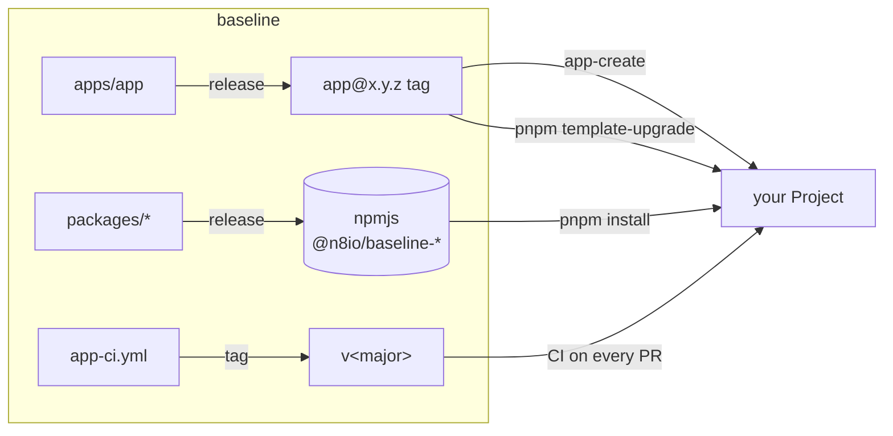

<p></p>

<p align="center"><b><a href="#start">Start</a> · <a href="#whats-inside">What's inside</a> · <a href="#pieces">Pieces</a> · <a href="#packages">Packages</a> · <a href="#in-a-project">In a Project</a> · <a href="#for-ai-agents">For AI agents</a></b></p>

A Template, fifteen Packages and one CI for TypeScript apps. Each Project gets a domain-driven Hono API and React Router pages in one process, a Worker for Events and Schedules, Postgres, Redis, OpenTelemetry and Infisical secrets.

## Start

```sh
pnpm app-create   # a new Project: rendered, on GitHub, CI started on main
pnpm dev          # Postgres, Redis, migrations, seed, the Worker and the dev server
```

Run `pnpm app-create` from a clone of this repo after `fnm use && pnpm install`, then `pnpm dev` inside the new Project. Needs Node 26 ([fnm](https://github.com/Schniz/fnm) reads `.node-version`), pnpm 12, Docker and a logged-in [GitHub CLI](https://cli.github.com), which creates the Project's repo (`--no-github` skips it).

<details><summary><b>What the two commands do</b></summary>

**`pnpm app-create`** renders the latest `app@` release with no Domain yet, creates a private GitHub repo whose main takes squash-merged pull requests only and needs every CI check, and runs CI once on main.

```sh
git clone https://github.com/n8io/baseline && cd baseline
fnm use && pnpm install   # fnm reads .node-version; the exact pnpm is in packageManager
pnpm app-create
```

It asks two questions; pass them as flags instead with `--name --description [--owner]`. [`docs/agents/project-create.md`](docs/agents/project-create.md) walks through it, including `--no-github` and `--github-only`.

**`pnpm dev`** starts Postgres 18 and Redis 8, migrates, seeds, then runs the Worker and the dev server. Open the URL it prints. The Worker restarts when a file it imports changes. Development uses a memory sign-in, so no identity provider is needed.

</details>

## What's inside

<table>
<tr>
<td width="33%" valign="top"><b>Domains, not folders of stuff</b><br>API, Use cases, Rules, ports and SPI in one layout per Domain. <code>pnpm domain-create</code> adds a whole Domain, wired and tested, once its term is in <code>CONTEXT.md</code>.</td>
<td width="33%" valign="top"><b>Events that keep their order</b><br>An Event commits with the write that caused it, reaches each Consumer in order per Event key, and an inbox skips a repeat. Schedules run in the Worker.</td>
<td width="33%" valign="top"><b>An API that documents itself</b><br>An OpenAPI document and an interactive reference at <code>/api/v1/docs</code>. CI fails a breaking change to it.</td>
</tr>
<tr>
<td valign="top"><b>Sign-in on day one</b><br>OIDC for pages, JWT checks for the API, users and machine clients as one Actor. A memory sign-in in development.</td>
<td valign="top"><b>Pages that update themselves</b><br>React Router pages that rerun their loaders when the data they show changes, across every instance.</td>
<td valign="top"><b>See every hop</b><br>One trace from the request through each Event it publishes, plus logs, error reports and analytics. Grafana runs locally behind one compose profile.</td>
</tr>
<tr>
<td valign="top"><b>Ready for production</b><br>Liveness and readiness probes, graceful shutdown in order, an Alpine image held to a size budget, and a Kubernetes guide.</td>
<td valign="top"><b>Secrets in one place</b><br>A typed env schema; values from Infisical, or plain env vars in production.</td>
<td valign="top"><b>Never left behind</b><br><code>pnpm template-upgrade</code> 3-way merges the newest Template release into your Project.</td>
</tr>
</table>

## Pieces

A Project starts with everything, and most Projects don't need all of it. A **piece** is an optional part of the stack: its files, the code blocks marked for it, its packages, env vars and Docker services. `pnpm piece-remove <piece>` takes all of that out in one step, then runs `pnpm check`. If the check fails, it undoes the removal. Commit each removal on its own; `git revert` and `pnpm install` bring the piece back.

<p></p>

| Piece            | What goes                                                          | What you're left with                                                |
| ---------------- | ------------------------------------------------------------------ | -------------------------------------------------------------------- |
| `ui`             | React Router pages, their components and the Vite dev server       | The API, sign-in, live update streams and the Worker, served by Hono |
| `api-reference`  | The interactive reference at `/api/v1/docs`                        | The OpenAPI document at `/api/v1/openapi.json`                       |
| `live`           | Live update streams to open pages                                  | Pages that show data as of their load                                |
| `cache`          | The read-through cache on each Domain's get                        | Every get reads Postgres                                             |
| `redis`          | The Redis connection and its Docker service (after live and cache) | Postgres as the only data store                                      |
| `queue`          | Events, Schedules and the Worker process                           | One long-running process; plain Postgres transactions                |
| `analytics`      | Analytics events and `MIXPANEL_TOKEN`                              | Nothing sent to product analytics                                    |
| `error-tracking` | Error reports and `SENTRY_DSN`                                     | Errors still logged                                                  |

`pnpm domain-create` leaves a removed piece out of every new Domain, and `pnpm template-upgrade` keeps it out. The `pieces` CI job removes each piece on a throwaway copy on every pull request that changes code, so they stay removable. The [pieces guide](apps/app/docs/agents/pieces.md) has the order rules and how to add one back.

## Packages

Projects depend on these. They are public on npmjs, so `pnpm add @n8io/baseline-<name>` needs no registry setup. Each wraps one concern behind a contract that does not name its vendor, and its README lists its exports, an example, and the env vars and peers it needs.

| I need to…                                                                 | Package                                     | Runs on            |
| -------------------------------------------------------------------------- | ------------------------------------------- | ------------------ |
| save an aggregate in one transaction, migrate, page by keyset, take a lock | [`postgres`](packages/postgres)             | pg, Drizzle        |
| tell another Domain something happened, or run on a Schedule               | [`queue`](packages/queue)                   | pg-boss            |
| refresh open pages when data changes                                       | [`live`](packages/live)                     | SSE, Redis pub/sub |
| skip a slow read, and keep working when the store is down                  | [`cache`](packages/cache)                   | Redis or memory    |
| share one connection between the cache and live updates                    | [`redis`](packages/redis)                   | node-redis         |
| know who is calling: OIDC sign-in, JWT checks and the Actor                | [`authn`](packages/authn)                   | any OIDC provider  |
| return an expected business error as `err(…)`, not a throw                 | [`result`](packages/result)                 |                    |
| give an entity a prefixed id no other entity's id can pass for             | [`id`](packages/id)                         | TypeID, UUIDv7     |
| shape API errors and add the API helpers                                   | [`http`](packages/http)                     | Hono               |
| see a request across processes                                             | [`telemetry`](packages/telemetry)           | OpenTelemetry      |
| log through the one logger, with credentials redacted                      | [`logger`](packages/logger)                 | pino               |
| hear about unexpected errors, linked to their trace                        | [`error-tracking`](packages/error-tracking) | Sentry             |
| track what an Actor did, sent without blocking                             | [`analytics`](packages/analytics)           | Mixpanel           |
| answer `/livez` and `/readyz`                                              | [`health`](packages/health)                 |                    |
| shut down gracefully, in order                                             | [`shutdown`](packages/shutdown)             |                    |

## In a Project

| Task                                                  | Command                     |
| ----------------------------------------------------- | --------------------------- |
| Lint, format check and typecheck                      | `pnpm check`                |
| Unit tests (memory adapters)                          | `pnpm test`                 |
| Integration tests (needs `docker compose up -d`)      | `pnpm test:integration`     |
| Most of CI (not oasdiff, migrations, sast, image)     | `pnpm run ci`               |
| Add a Domain                                          | `pnpm domain-create <name>` |
| Remove a piece                                        | `pnpm piece-remove <piece>` |
| Generate a migration after editing a `spi/*-table.ts` | `pnpm codegen`              |
| Pull the newest Template release                      | `pnpm template-upgrade`     |

> [!TIP]
> `pnpm template-upgrade` does a 3-way merge between the release your Project came from and the newest one. Resolve every conflict marker before you commit.

The Project's own [`AGENTS.md`](apps/app/AGENTS.md) holds the rules every task needs: where new work goes, secrets rules, and when to stop and ask. It links the task-specific rules in [`docs/agents/`](apps/app/docs/agents/), which an agent reads only when the task needs them.

## For AI agents

Built to be read cold. Start with these files, in this order:

1. [`AGENTS.md`](AGENTS.md): this repo's verify commands and test rules, as a short index.
2. [`CONTEXT-MAP.md`](CONTEXT-MAP.md): the glossaries. Use their terms in code, tests, PRs and commits.
3. [`apps/app/AGENTS.md`](apps/app/AGENTS.md) and [`apps/app/CONTEXT.md`](apps/app/CONTEXT.md): the rules and terms every Project inherits.

Walkthroughs live in [`docs/agents/`](docs/agents/): ask "Walk me through creating a Project with docs/agents/project-create.md."

```text
.github/workflows/  ci.yml (this repo), app-ci.yml (called by Projects), release.yml
apps/app/           the Template: src/domains/foo is the example Domain
packages/*          the @n8io/baseline-* Packages
scripts/            app-create.ts, and readme-svg/ for these diagrams
test/               app-create tests and the render-and-test check
```

<details><summary><b>Working on baseline</b></summary>

```sh
fnm use && pnpm install
pnpm turbo run check test build   # the full CI-equivalent
```

Docker must be running: the root tests and the `cache`, `live`, `postgres`, `queue` and `redis` tests start their own containers.



A change that should ship needs a changeset. Run `pnpm changeset` and pick the Packages it touches, plus `app` for Template changes. On merge, a "Version packages" PR opens. Merging that PR publishes the Packages, tags `app@x.y.z`, and moves `v<major>` (the Template's major) to it.

Dependabot opens update PRs weekly, for releases at least 7 days old. Patch and minor updates come grouped in one PR that merges itself once CI passes; each major is its own PR to review and merge by hand. Update PRs carry no changeset, so they never publish. Add one to a major only if it should ship.

The README diagrams are generated: edit `scripts/readme-svg/<name>.ts`, run `pnpm readme-svg`, and commit both. The rules are in [`docs/agents/readmes.md`](docs/agents/readmes.md).

> [!WARNING]
> `app-ci.yml@v<major>` follows the Template's major, and older majors stay frozen. A major never gains a check that can fail on Projects that passed before, and never adds, renames or removes a job (a required check); a change like that ships with the next Template major.

</details>

## License

[MIT](LICENSE). Report vulnerabilities as [`SECURITY.md`](SECURITY.md) describes.
