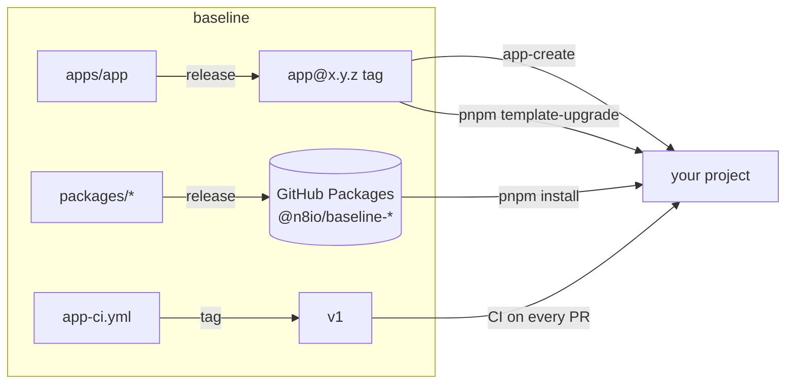

# baseline

A template for TypeScript projects. It has three parts:

- 12 shared `@n8io/baseline-*` packages.
- The `apps/app` template that new projects are made from.
- The CI workflow every project runs.

Each project gets a domain-driven Hono API and React Router pages in one process, a Worker for events and schedules, Postgres, Redis, OpenTelemetry and 1Password secrets.



## Quick start

> [!NOTE]
> You need Node 26 ([fnm](https://github.com/Schniz/fnm) reads `.node-version`), pnpm 12 (the exact version is in `packageManager`), Docker, and the [GitHub CLI](https://cli.github.com) logged in to `n8io`.

**1. Let pnpm read the private packages.** Do this once per machine.

```sh
gh auth refresh -s read:packages
echo "//npm.pkg.github.com/:_authToken=$(gh auth token)" >> ~/.npmrc
```

**2. Create a project.** This renders the latest `app@` release, adds your first Domain, and creates a private GitHub repo with a CI ruleset.

```sh
git clone https://github.com/n8io/baseline && cd baseline
fnm use && pnpm install
node scripts/app-create.ts
```

It asks five questions. You can pass them as flags instead: `--name --description --domain --plural --definition [--owner]`.

**3. Give the new repo access to the packages.**

> [!IMPORTANT]
> CI and Dependabot install the packages with the repo's built-in `GITHUB_TOKEN`. That works only after each package lists the repo. GitHub has no API for this, so `app-create` ends by printing the 12 links. On each one, open **Manage Actions access**, click **Add Repository**, and choose **Read**.

**4. Run it.**

```sh
cd <your-project>
docker compose up -d   # Postgres 18 and Redis 8
pnpm dev               # migrate, seed, then the Worker and the dev server
```

Open the URL `pnpm dev` prints. Development uses a memory sign-in, so no identity provider is needed.

## In a project

| Task                                                  | Command                     |
| ----------------------------------------------------- | --------------------------- |
| Lint, format check and typecheck                      | `pnpm check`                |
| Unit tests (memory adapters)                          | `pnpm test`                 |
| Integration tests (needs `docker compose up -d`)      | `pnpm test:integration`     |
| Everything CI runs                                    | `pnpm run ci`               |
| Add a Domain                                          | `pnpm domain-create <name>` |
| Generate a migration after editing a `spi/*-table.ts` | `pnpm codegen`              |
| Pull the newest template release                      | `pnpm template-upgrade`     |

The project's own [`AGENTS.md`](apps/app/AGENTS.md) holds the rules every task needs: where new work goes, secrets rules, and when to stop and ask. It links the task-specific rules in [`docs/agents/`](apps/app/docs/agents/), which an agent reads only when the task needs them.

> [!TIP]
> `pnpm template-upgrade` does a 3-way merge between the release your project came from and the newest one. Resolve every conflict marker before you commit.

## Packages

Projects depend on these. They are private, on GitHub Packages.

| Package                           | What it does                                             |
| --------------------------------- | -------------------------------------------------------- |
| [`authn`](packages/authn)         | OIDC code flow, JWT verification and the Actor           |
| [`cache`](packages/cache)         | Typed cache on Redis or memory                           |
| [`health`](packages/health)       | `/livez` and `/readyz` probes                            |
| [`http`](packages/http)           | Hono error handling and helpers                          |
| [`id`](packages/id)               | Prefixed TypeIDs, to and from UUIDs                      |
| [`live`](packages/live)           | Live updates over SSE and Redis pub/sub                  |
| [`logger`](packages/logger)       | The one pino logger                                      |
| [`postgres`](packages/postgres)   | Pool, transactions, migrations and id columns on Drizzle |
| [`pulsar`](packages/pulsar)       | Events and Consumers on Apache Pulsar, sent after commit |
| [`queue`](packages/queue)         | pg-boss Events, Consumers and Schedules with an inbox    |
| [`result`](packages/result)       | `Result`, `ok` and `err` for expected business errors    |
| [`shutdown`](packages/shutdown)   | Graceful shutdown in order                               |
| [`telemetry`](packages/telemetry) | OpenTelemetry preload and use-case spans                 |

## Working on baseline

```sh
fnm use && pnpm install
pnpm turbo run check test build   # the full CI-equivalent
```

A change that should ship needs a changeset. Run `pnpm changeset` and pick the packages it touches, plus `app` for template changes. On merge, a "Version packages" PR opens. Merging that PR publishes the packages, tags `app@x.y.z`, and moves `v1`.

Dependabot opens update PRs weekly, for releases at least 7 days old. Patch and minor updates come grouped in one PR that merges itself once CI passes; each major is its own PR to review and merge by hand. Update PRs carry no changeset, so they never publish. Add one to a major only if it should ship.

> [!WARNING]
> `v1` of `app-ci.yml` never gains a check that can fail on projects that passed before. A change like that ships as `v2`.

## For AI agents

Start with these files, in this order:

1. [`AGENTS.md`](AGENTS.md): this repo's verify commands and test rules.
2. [`CONTEXT-MAP.md`](CONTEXT-MAP.md): the glossaries. Use their terms in code, tests, PRs and commits.
3. [`apps/app/AGENTS.md`](apps/app/AGENTS.md) and [`apps/app/CONTEXT.md`](apps/app/CONTEXT.md): the rules and terms every project inherits.

```text
.github/workflows/  ci.yml (this repo), app-ci.yml (called by projects), release.yml
apps/app/           the template: src/domains/foo is the example Domain
packages/*          the @n8io/baseline-* packages
scripts/            app-create.ts
test/               app-create tests and the render-and-test check
```
