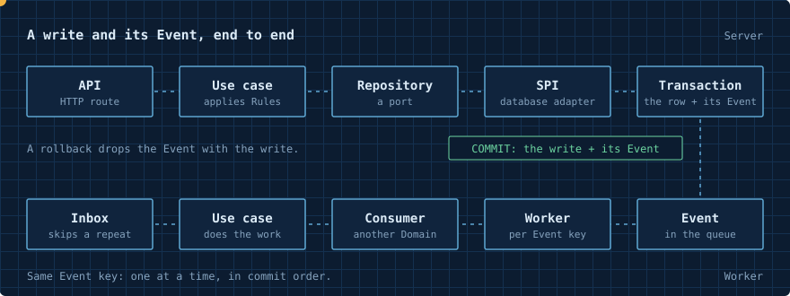

# app

**A starter app with the layout and patterns every Project made from baseline shares.**

<sub>The [baseline](https://github.com/n8io/baseline) Template. `pnpm app-create` renders it into a new Project, whose README gets the Project's name and description and names the release it was made from.</sub>

<p></p>

## Start

```sh
fnm use && pnpm install
pnpm dev
```

`pnpm dev` starts Postgres and Redis in Docker, migrates, seeds, then runs the Worker beside the dev server: open the URL it prints. Development signs in through a memory issuer and reads plain values from `.env.development`, so it needs no identity provider and no secrets. Needs Node 26 ([fnm](https://github.com/Schniz/fnm) reads `.node-version`), the pnpm that `packageManager` names, and Docker.

## What runs

| Part     | What it does                                                                                                           | Runs on            |
| -------- | ---------------------------------------------------------------------------------------------------------------------- | ------------------ |
| Server   | The API under `/api/v1` with its OpenAPI document and reference page at `/api/v1/docs`, the UI pages, and live updates | Hono, React Router |
| Worker   | Consumers, which get each Event once it commits, in order per Event key, and Schedules                                 | pg-boss            |
| Database | Every Domain's tables, and the Events waiting for the Worker                                                           | Postgres 18        |
| Cache    | The read-through cache, and the fan-out of live updates to every Server                                                | Redis 8            |

Every request is one trace through each Event it publishes; `compose.yaml`'s `telemetry` profile shows traces and logs in Grafana on `localhost:3001` (how is at the top of that file). The UI pages, live updates, the cache, Redis, the queue, analytics, error reports and the API reference are pieces: `pnpm piece-remove <piece>` takes out one this Project does not use, and `pnpm piece-check` proves each still can.

## Domains

A Domain is one business entity: a folder in `src/domains/` with the API, Use cases, Rules, ports and SPI in the same layout, named by its term in [CONTEXT.md](CONTEXT.md). This Project's Domains are the folders there; a new Project has none. Agree the term, add its `**Term**:` entry under Language, then:

```sh
pnpm domain-create invoice --bare   # the core only; pnpm domain-create --help lists the parts
pnpm codegen --name invoice_create  # its migration, after you shape the Model and its table
```

## Commands

| I want to…                                    | Run                                             |
| --------------------------------------------- | ----------------------------------------------- |
| run the app, the Worker and their services    | `pnpm dev`                                      |
| wipe the local Postgres and Redis data        | `pnpm dev:reset`                                |
| lint, check formatting and typecheck          | `pnpm check`                                    |
| format                                        | `pnpm format`                                   |
| run the unit tests, on memory adapters        | `pnpm test`                                     |
| run the integration tests (`pnpm dev` first)  | `pnpm test:integration`                         |
| run most of CI before I push                  | `pnpm run ci`                                   |
| add a Domain                                  | `pnpm domain-create <name>`                     |
| write a migration after a table change        | `pnpm codegen`                                  |
| migrate or seed by hand                       | `pnpm migrate`, `pnpm seed`                     |
| catch a breaking API change                   | `pnpm api-check`                                |
| remove a piece, or prove each still comes out | `pnpm piece-remove <piece>`, `pnpm piece-check` |
| take a newer Template release                 | `pnpm template-upgrade`                         |
| find glossary aliases                         | `pnpm glossary-check`                           |
| build for production                          | `pnpm build`                                    |

## For AI agents

Read [AGENTS.md](AGENTS.md) first: it holds the commands, the rules and where new work goes, and loads [CONTEXT.md](CONTEXT.md), the glossary every name follows. Task rules live in [docs/agents/](docs/agents/), and AGENTS.md says when to read each one.
