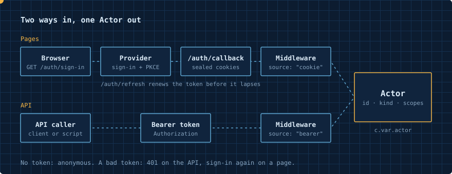

# @n8io/baseline-authn

**Every request arrives with one Actor**: pages sign in through any OIDC provider, the API checks bearer tokens, and both hand your Use cases the same `{ id, kind, scopes }`.

```sh
pnpm add @n8io/baseline-authn
```

<p align="center"></p>

## Guarantees

| You get                                     | How                                                                                                                                                   |
| ------------------------------------------- | ----------------------------------------------------------------------------------------------------------------------------------------------------- |
| **One Actor, pages and API alike**          | Both middlewares set `c.var.actor`. Your `actorFromClaims` maps the claims; a result that is not an Actor counts as an invalid token.                 |
| **Tokens JavaScript never sees**            | Access and refresh tokens live in encrypted cookies (A256GCM, keyed from `secret`), `HttpOnly`, `Secure`, `SameSite=Lax`, each bound to its own name. |
| **A hardened code flow**                    | PKCE, `state` and `nonce` on every sign-in. `returnTo` only ever names a path on this site.                                                           |
| **Sign-ins that don't lapse mid-click**     | A page refreshes its token before it expires, one refresh per tab, with Web Locks across tabs.                                                        |
| **A bad token is never anonymous**          | No token: anonymous. An invalid one: 401 on the API, cleared cookies and sign-in again on a page.                                                     |
| **An outage is not a sign-out**             | A key set that will not load answers 500; only a token that is wrong in itself is refused.                                                            |
| **Sign-in with no provider in development** | `memory://` offers one button per entry of `memoryUsers`, serves machine-client tokens, and is refused unless you allow it.                           |
| **Signed in on every pod**                  | Any Server with the same `secret` opens the cookies and memory-issuer tokens of every other.                                                          |
| **Traces name the Actor**                   | The middleware sets `user.id` to the Actor's id on the request's span.                                                                                |
| **No React on the API**                     | The main entry imports neither React nor React Router; pages import two subpaths.                                                                     |

## Example

```ts
import { authnCreate } from "@n8io/baseline-authn";

const authn = await authnCreate({
	actorFromClaims, // your claims to an Actor; see Checking claims with Zod
	audience: ENV.AUTHN_AUDIENCE,
	clientId: ENV.AUTHN_CLIENT_ID,
	clientSecret: ENV.AUTHN_CLIENT_SECRET,
	issuerUrl: ENV.AUTHN_ISSUER_URL, // https://… or memory://
	memoryIssuerAllowed: ENV.APP_ENV !== "production", // memory:// needs it
	secret: ENV.AUTHN_SECRET,
});
```

Then mount the middlewares and the routes:

```ts
import { authnMiddlewareCreate, authnRoutesCreate } from "@n8io/baseline-authn";
import { except } from "hono/combine";

const pages = authnMiddlewareCreate(authn, { source: "cookie" });
app.use("*", except(["/api/*"], pages));
app.use("/api/v1/*", authnMiddlewareCreate(authn, { source: "bearer" }));
app.route("/auth", authnRoutesCreate(authn));
```

A route then calls `authnActorRequire(c)` for the signed-in Actor (else 401), and a loader calls `authnPageActorRequire(args)` (else a redirect to sign-in).

Test a route with no provider and no server: `authnTestBearerCreate` gives you an `Authn` and bearer tokens.

```ts
import { authnActorRequire, authnMiddlewareCreate } from "@n8io/baseline-authn";
import { authnTestBearerCreate } from "@n8io/baseline-authn/testing";
import { Hono } from "hono";

const { authn, tokenFor } = await authnTestBearerCreate({ actorFromClaims });
const app = new Hono()
	.use("/api/*", authnMiddlewareCreate(authn, { source: "bearer" }))
	.get("/api/me", (c) => c.json(authnActorRequire(c)));
const res = await app.request("/api/me", {
	headers: { authorization: `Bearer ${await tokenFor(actor)}` },
});
```

## Reference

<details><summary><b>Exports</b></summary>

| Export                                                                                                                                    | Does                                                                                                                                                                                                                                                                                                     |
| ----------------------------------------------------------------------------------------------------------------------------------------- | -------------------------------------------------------------------------------------------------------------------------------------------------------------------------------------------------------------------------------------------------------------------------------------------------------- |
| `authnCreate(options)`, `AuthnOptions`, `Authn`                                                                                           | Discovers the OIDC provider, or starts the memory issuer when `issuerUrl` is `memory://`. Returns the `Authn` the other functions take; it is opaque, with no fields to read. Throws a `TypeError` on a bad option, including an `audienceClaim` that is neither `"aud"` nor `"client_id"`. See Options. |
| `authnMiddlewareCreate(authn, { source })`, `AuthnMiddlewareOptions`                                                                      | Sets `c.var.actor` and `c.var.authnExpiresAt` from a `"bearer"` token (API) or the `"cookie"` sign-in (pages). A missing token stays anonymous; an invalid one is a 401 or a redirect to sign-in. Throws a `TypeError` on a `source` that is neither `"bearer"` nor `"cookie"`.                          |
| `authnRoutesCreate(authn)`                                                                                                                | `/sign-in`, `/refresh` and `/sign-out`, plus `/callback` with an OIDC provider or `POST /token` with the memory issuer. Mount them at `/auth` and nowhere else: the middleware, cookie paths and page helpers name `/auth`. See Routes and cookies.                                                      |
| `authnActorRequire(c)`                                                                                                                    | The signed-in Actor of an API request, else it throws `AuthnRequiredError`.                                                                                                                                                                                                                              |
| `Actor`                                                                                                                                   | The type `{ id, kind: "user" \| "client", scopes }`.                                                                                                                                                                                                                                                     |
| `AuthnClaims`                                                                                                                             | The verified token's claims, a plain `Record<string, unknown>`, as `actorFromClaims` gets them.                                                                                                                                                                                                          |
| `AuthnRequiredError`                                                                                                                      | The 401 `AuthnRequired` that `authnActorRequire` throws. `httpErrorHandle` from `@n8io/baseline-http` turns it into a problem body.                                                                                                                                                                      |
| `AuthnInvalidError`                                                                                                                       | The 401 `AuthnInvalid` the bearer middleware throws for an invalid token. `httpErrorHandle` from `@n8io/baseline-http` turns it into a problem body.                                                                                                                                                     |
| `authnMemoryTokenFetch({ baseUrl, clientId, scopes? })`, `AuthnMemoryTokenFetchOptions`, `AuthnMemoryToken`                               | A machine client's bearer token from a served Project's memory issuer, for scripts and dev tools: `{ authorization, expiresAt, token }`, `expiresAt` in epoch ms. `baseUrl` is the Project's origin. See Machine clients.                                                                                |
| `authnMemoryAuthorizationCreate({ baseUrl, clientId, scopes?, renewMs? })`, `AuthnMemoryAuthorizationOptions`, `AuthnMemoryAuthorization` | A function that returns the current `Authorization` value and fetches a new token before the held one expires. See Machine clients.                                                                                                                                                                      |
| `AuthnMemoryUser`                                                                                                                         | An entry of `memoryUsers`.                                                                                                                                                                                                                                                                               |
| `AuthnMemoryClient`                                                                                                                       | An entry of `memoryClients`.                                                                                                                                                                                                                                                                             |
| `@n8io/baseline-authn/react-router`: `actorContext`, `authnExpiresAtContext`                                                              | The React Router contexts your load context fills (`[actorContext, c.var.actor]`, `[authnExpiresAtContext, c.var.authnExpiresAt]`; without them `authnPageActorRequire` always redirects).                                                                                                               |
| `@n8io/baseline-authn/react-router`: `authnPageActorRequire(args)`                                                                        | The signed-in Actor of a loader or action, else a document redirect to `/auth/sign-in?returnTo=<this page>`.                                                                                                                                                                                             |
| `@n8io/baseline-authn/client`: `authnRefreshClientMiddleware`                                                                             | The root route's `clientMiddleware`. Before a navigation or form submission with under a minute left on the token, it refreshes with `fetch`; the root loader returns `authnExpiresAt` for it to read. A failed refresh is left to the Server.                                                           |
| `@n8io/baseline-authn/testing`: `authnTestBearerCreate(options)`, `AuthnTestBearerOptions`, `AuthnTestBearer`                             | An `Authn` on the memory issuer and a `tokenFor(actor)` for bearer tokens, for a route test that builds its own app.                                                                                                                                                                                     |
| `@n8io/baseline-authn/testing`: `authnTestSignIn(options)`, `AuthnTestSignInOptions`, `AuthnTestSignedIn`                                 | Signs in at a served Project's memory issuer and returns its `authorization` and `cookie`. Throws if the Server does not sign in or its `secret` does not open the access cookie.                                                                                                                        |
| `@n8io/baseline-authn/testing`: `authnTestTokenCreate({ authn, actor })`, `AuthnTestTokenOptions`                                         | A memory issuer bearer token, for a test that holds the `Authn`.                                                                                                                                                                                                                                         |

Pages import `/react-router` and `/client`; only test files import `/testing`. An API-only Project installs neither React nor React Router. See Testing.

</details>

<details><summary><b>Options</b></summary>

| Option                     | Does                                                                                                                                                                                                  |
| -------------------------- | ----------------------------------------------------------------------------------------------------------------------------------------------------------------------------------------------------- |
| `issuerUrl`                | The provider's issuer, `https://…`, or `memory://` for the memory issuer. Any other scheme throws.                                                                                                    |
| `clientId`, `clientSecret` | The Project's client at the provider.                                                                                                                                                                 |
| `audience`                 | The `aud` every access token must carry.                                                                                                                                                              |
| `secret`                   | Base64url, at least 32 bytes. Encrypts every authn cookie and keys the memory issuer.                                                                                                                 |
| `actorFromClaims(claims)`  | Maps the verified token's claims to an Actor; a throw means "not an Actor".                                                                                                                           |
| `authorizeParams`          | Extra authorization request params, such as `{ audience }` for a provider that asks for one. Sign-in asks for `openid offline_access` unless this sets `scope`; the provider must return an id token. |
| `audienceClaim`            | `"client_id"` for a provider that names the client in `client_id` instead of `aud`: that claim must then equal `audience`. Default `"aud"`.                                                           |
| `memoryIssuerAllowed`      | Must be `true` for `memory://`; pass it only in development and test.                                                                                                                                 |
| `memoryUsers`              | The people the memory issuer's sign-in page offers. Default one `dev-user` without scopes.                                                                                                            |
| `memoryClients`            | The machine clients the memory issuer's `POST /auth/token` serves. Default none.                                                                                                                      |

`authnCreate` throws on a secret under 32 bytes, a scheme other than `https://` or `memory://`, `memory://` without `memoryIssuerAllowed`, an id listed twice in `memoryUsers` or `memoryClients`, a provider it cannot reach, or one that advertises no `jwks_uri`. `authnCreate` also throws a `TypeError` on an `audienceClaim` that is neither `"aud"` nor `"client_id"`. `authnMemoryAuthorizationCreate` throws a `TypeError` on a negative or non-finite `renewMs`.

</details>

<details><summary><b>Routes and cookies</b></summary>

Every route answers `Cache-Control: no-store`. Register `<public origin>/auth/callback` as the redirect URI and `<public origin>/` as the post-logout redirect at your provider; behind a TLS proxy the origin is https when `x-forwarded-proto` says so.

- `GET /auth/sign-in?returnTo=…`: starts the code flow (PKCE, `state`, `nonce`), or shows the memory issuer's sign-in page. `returnTo` keeps only a same-site path, else `/`.
- `GET /auth/callback`: finishes the code flow, sets the cookies and redirects to `returnTo`. A refused flow shows a "sign-in failed" page (400).
- `GET /auth/refresh?returnTo=…`: refreshes both cookies and redirects back, or to sign-in when it fails. Without `returnTo` (the client middleware) it answers `{ expiresAt }` or 401. A token another tab just refreshed needs no new grant, and a failed refresh leaves the cookies alone.
- `POST /auth/sign-in`: the memory issuer's sign-in form (`who`, optional `returnTo`); an unknown `who` is 400.
- `POST /auth/sign-out`: clears the cookies, revokes the refresh token where the provider supports it, and ends the provider's session where it has an end-session endpoint.
- `POST /auth/token`: the memory issuer's client-credentials grant. See Machine clients.

The cookies are `__Host-authn` (access, path `/`, 30 days), `__Secure-authn-refresh` (path `/auth`, 30 days) and `__Secure-authn-flow` (path `/auth/callback`, 10 minutes). A page GET whose token expires within 10 s goes through `/auth/refresh` first. A form post with an expired token cannot be replayed, so it signs in again. React Router's data requests get a document redirect, since they cannot follow one across sites.

</details>

<details><summary><b>Checking claims with Zod</b></summary>

You bring your own schema library. To check the token's claims with Zod, parse them in `actorFromClaims`; a throw means the token is not an Actor's:

```ts
import type { Actor, AuthnClaims } from "@n8io/baseline-authn";
import { z } from "zod";

const Claims = z.object({
	sub: z.string().min(1),
	scope: z.string().default(""),
});

export const actorFromClaims = (claims: AuthnClaims): Actor => {
	const { sub, scope } = Claims.parse(claims);
	return { id: sub, kind: "user", scopes: scope.split(" ").filter(Boolean) };
};
```

</details>

<details><summary><b>Roles in development</b></summary>

The memory issuer (`issuerUrl` `memory://`) signs in without a password. Its sign-in page offers one button per entry of `memoryUsers`, so you can try every role your Project has:

```ts
const authn = await authnCreate({
	// ...the options above
	memoryUsers: [
		{ id: "dev-user", name: "Dev user", scopes: [] },
		{ id: "dev-admin", name: "Dev admin", scopes: ["invoice:delete"] },
	],
});
```

Without `memoryUsers` the page offers one `dev-user` without scopes. The token's `sub` is the entry's `id`; the `name` is the button's label. A refresh re-reads the entry, so a changed or removed one takes effect at the next refresh.

The memory issuer signs with HS256 and a key derived from `secret`, so every Server with the same `secret` accepts the tokens of every other: a sign-in started at one pod refreshes at the next, and a script's token works at any of them.

</details>

<details><summary><b>Machine clients</b></summary>

`memoryClients` lists the machine clients the memory issuer serves at `POST /auth/token`, the OAuth client-credentials grant without a client secret:

```ts
memoryClients: [{ id: "score-feed", scopes: ["score:write"] }],
```

A script fetches a token with `authnMemoryTokenFetch` and calls the API with it:

```ts
import { authnMemoryTokenFetch } from "@n8io/baseline-authn";

const baseUrl = "http://<instance>.localhost:<PORT>"; // the Project's origin

const { authorization } = await authnMemoryTokenFetch({
	baseUrl,
	clientId: "score-feed",
});
await fetch(`${baseUrl}/api/v1/scores`, {
	body: JSON.stringify(score),
	headers: { authorization, "content-type": "application/json" },
	method: "POST",
});
```

- `scopes` asks for a subset of the client's scopes; it defaults to all of them. A scope the client does not have answers 400 `invalid_scope`, an unknown client 401 `invalid_client`.
- The token carries `gty: "client-credentials"`, which the Template's `actorFromClaims` reads as an Actor of kind `"client"`.
- With an OIDC provider there is no `/auth/token` (404), and `authnMemoryTokenFetch` rejects with a message naming the issuer: create the machine client at your provider instead.

A memory token lives 15 minutes, and nothing renews it. A script that runs longer, such as a feed, asks `authnMemoryAuthorizationCreate` for its `Authorization` value before each call instead:

```ts
import { authnMemoryAuthorizationCreate } from "@n8io/baseline-authn";

const authorization = authnMemoryAuthorizationCreate({
	baseUrl,
	clientId: "score-feed",
});
const scorePost = async (score: Score) =>
	fetch(`${baseUrl}/api/v1/scores`, {
		body: JSON.stringify(score),
		headers: {
			authorization: await authorization(),
			"content-type": "application/json",
		},
		method: "POST",
	});
```

- It holds one token and fetches a new one when the held one expires within `renewMs` (default 60,000, at most half the token's lifetime). Callers that ask while a fetch runs share it, and a failed fetch rejects them all and is tried again on the next call. A failed early fetch (inside the margin) answers with the held token while it still lives.
- `authorization({ renew: true })` fetches a new token first: call it once after a 401, then give up if the retry is refused too.

</details>

<details><summary><b>Testing</b></summary>

A route test that builds its own app uses `authnTestBearerCreate` (see the Example), which makes its own secret. A test that already holds the Server's `Authn` uses `authnTestTokenCreate`. A test that only has a served Project's URL signs in with `authnTestSignIn`. All of them need the memory issuer (`issuerUrl` `memory://`). Import `/testing` from test files only.

```ts
import { authnTestSignIn } from "@n8io/baseline-authn/testing";

const baseUrl = "http://<instance>.localhost:<PORT>"; // the served Project's origin

const signedIn = await authnTestSignIn({
	baseUrl,
	secret: ENV.AUTHN_SECRET,
	who: "dev-admin",
});

await fetch(`${baseUrl}/api/v1/invoices`, {
	headers: { authorization: signedIn.authorization },
});
await fetch(`${baseUrl}/invoices`, {
	headers: { cookie: signedIn.cookie },
});
```

- `who` is the `id` of one of the Server's `memoryUsers`; an unknown id fails with the status (400).
- `secret` is the Server's `secret`. The helper opens the access cookie with it, and throws when it is another Server's.
- It returns `authorization` (the `Authorization` header value), `cookie` (the `Cookie` header value), `token` (the access token) and `accessCookie` (the access cookie's sealed value).

</details>

<details><summary><b>Environment</b></summary>

By the Template's convention: `AUTHN_ISSUER_URL` (`https://` or `memory://`), `AUTHN_CLIENT_ID`, `AUTHN_CLIENT_SECRET`, `AUTHN_AUDIENCE`, and `AUTHN_SECRET` (base64url, at least 32 bytes; it encrypts the cookies and keys the memory issuer). Make one with `openssl rand -base64 32 | tr '+/' '-_' | tr -d '='`.

</details>

**Needs** `hono` and `@opentelemetry/api` as peers; `react-router` only for the `/react-router` and `/client` subpaths. Zod is its own dependency, not yours. Env: the five `AUTHN_*` above. Runs on any OIDC provider (`openid-client`, `jose`); no option or export is specific to one provider.
