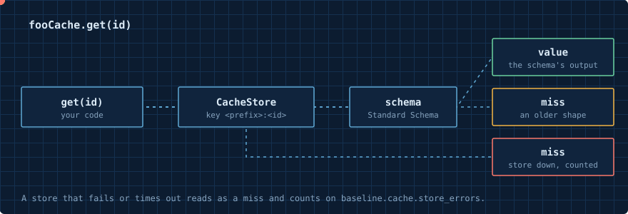

# @n8io/baseline-cache

**A typed cache that, by default, never takes your app down with it.** Every read is checked by the schema you give it, an entry in an older shape reads as a miss, and a store that fails reads as a miss too.

```sh
pnpm add @n8io/baseline-cache
```

<p align="center"></p>

## Guarantees

| You get                                                | How                                                                                                                                                            |
| ------------------------------------------------------ | -------------------------------------------------------------------------------------------------------------------------------------------------------------- |
| **Typed reads**                                        | Each `get` runs the stored JSON through your schema; the cache's type is the schema's output.                                                                  |
| **Old entries are misses, not crashes**                | A value the schema refuses, such as one an older version of your app wrote, reads as `undefined`.                                                              |
| **Any schema library**                                 | Any [Standard Schema](https://standardschema.dev): a Zod, Valibot or ArkType schema goes in as it is. The Package imports none.                                |
| **Up while the store is down**                         | By default `get` misses and `set` and `delete` resolve. Each failure counts on `baseline.cache.store_errors`, with one warning log per 30 s per cache.         |
| **This process never serves what it tried to replace** | By default, after a failed `set` or `delete` this process reads that id as a miss for `ttlMs`. Other processes may still serve the old entry until it expires. |
| **Bounded staleness**                                  | Entries expire after `ttlMs`, 60 s by default.                                                                                                                 |
| **One store, many caches**                             | Open one `CacheStore` per process; keys are `<prefix>:<id>`. Swapping the backend touches one file.                                                            |

## Example

```ts
import { cacheCreate } from "@n8io/baseline-cache";
import { z } from "zod";

const Foo = z.object({ createdAt: z.coerce.date(), name: z.string() });

const fooCache = cacheCreate(cacheStore, {
	prefix: "foo",
	schema: Foo,
	ttlMs: 30_000,
});

await fooCache.set(foo.id, foo);
const cached = await fooCache.get(foo.id); // the Foo, or undefined
```

Entries are JSON, so a `Date` comes back as a string: `z.coerce.date()` turns it back, or every read would be a miss. In unit tests build the cache on `cacheStoreMemoryCreate()`. It stores JSON as the Redis store does, and its expiry reads `Date.now`, so fake timers move it. The Package's own `pnpm test` needs Docker for Redis; `pnpm test:unit` runs the tests that need no Redis.

## Reference

<details><summary><b>Exports</b></summary>

| Export                                   | Does                                                                                                                                                                                                                                                                                                                                                                                                    |
| ---------------------------------------- | ------------------------------------------------------------------------------------------------------------------------------------------------------------------------------------------------------------------------------------------------------------------------------------------------------------------------------------------------------------------------------------------------------- |
| `cacheCreate(store, options)`            | A cache on a store, from `{ prefix, schema, keyOf?, ttlMs?, onStoreError? }`. Keys are `<prefix>:<id>` and entries expire after `ttlMs` (default 60 s). `schema` is any [Standard Schema](https://standardschema.dev): a Zod, Valibot or ArkType schema goes in as it is. A stored value that fails the schema reads as a miss. It keeps working when the store does not: see "When the store is down". |
| `Cache<T>`                               | What `cacheCreate` returns: `get(id)`, `set(id, value)` and `delete(id)`.                                                                                                                                                                                                                                                                                                                               |
| `CacheKeyed<T>`                          | What `cacheCreate` returns with `keyOf: (value) => id`, for values that carry their own id: the same, but `set(value)` takes the value alone (`get(id)` and `delete(id)` are unchanged), so no wrapper is needed.                                                                                                                                                                                       |
| `CacheOptions`, `CacheKeyedOptions`      | The options types for `cacheCreate`, without and with `keyOf`.                                                                                                                                                                                                                                                                                                                                          |
| `CacheStore`                             | Where entries live, as JSON strings by key with a TTL. Open one per process and build every cache on it; a new backend is one more `CacheStore`.                                                                                                                                                                                                                                                        |
| `cacheStoreRedisCreate({ redisClient })` | A store on a connected node-redis client. Each call fails after 1 s without an answer, which the cache on top treats like any other store failure.                                                                                                                                                                                                                                                      |
| `CacheStoreRedisOptions`                 | What `cacheStoreRedisCreate` takes.                                                                                                                                                                                                                                                                                                                                                                     |
| `cacheStoreMemoryCreate()`               | A store in process, for unit tests and `memory://`. Caches on one store share its keys, as on Redis, so give each its own `prefix`.                                                                                                                                                                                                                                                                     |

</details>

<details><summary><b>Picking the store in one place</b></summary>

Pick the store in one place, and name no backend anywhere else:

```ts
// src/cache-store-open.ts: the only file that knows the backend
import {
	cacheStoreMemoryCreate,
	cacheStoreRedisCreate,
} from "@n8io/baseline-cache";
import type { RedisClient } from "@n8io/baseline-redis";

export const cacheStoreOpen = ({ redis }: { redis: RedisClient | "memory" }) =>
	redis === "memory"
		? cacheStoreMemoryCreate()
		: cacheStoreRedisCreate({ redisClient: redis });
```

</details>

<details><summary><b>Schemas</b></summary>

Pass a Zod schema as `schema`. The cache's value type is the schema's output:

```ts
import { type CacheStore, cacheCreate } from "@n8io/baseline-cache";
import { z } from "zod";

declare const cacheStore: CacheStore; // from cacheStoreOpen

const Foo = z.object({ name: z.string() });

const fooCache = cacheCreate(cacheStore, {
	prefix: "foo",
	schema: Foo,
	ttlMs: 30_000,
}); // Cache<{ name: string }>

await fooCache.set("foo_01", { name: "First" });
const foo = await fooCache.get("foo_01"); // { name: "First" } or undefined
```

Entries are JSON, so a `Date` comes back as a string. Give the cache a schema that turns it back, or every read is a miss:

```ts
const FooCached = z.object({ name: z.string(), createdAt: z.coerce.date() });
```

The package does not import Zod. Any Standard Schema works the same way, for example Valibot's `v.object({ name: v.string() })`.

</details>

<details><summary><b>When the store is down</b></summary>

A cache is an optimization, so by default a store that fails or times out never fails the caller:

- `get` is a miss, so the caller reads the source of truth.
- `set` and `delete` resolve.
- Every failure is counted on `baseline.cache.store_errors` (by `baseline.cache.operation` and `baseline.cache.prefix`), and logged as one warning per 30 s per cache, so you can alert on an outage without a log line per call.

A `set` or `delete` that fails leaves the old entry in the store. The process that called it remembers the id for `ttlMs` and reads it as a miss, so it never serves the value it tried to replace. Other processes may.

Pass `onStoreError: "throw"` to get the store's error from every call instead, for a value you would rather fail on than read without the cache.

</details>

<details><summary><b>How stale a read can be</b></summary>

The cache does not see writes to the source of truth: you `delete` (or `set`) after each one. When that call is lost (the store is down, or the process dies between the commit and the call), other processes can serve the old value until its entry expires: at most `ttlMs`, 60 s by default. For a value that cannot be that stale, shorten `ttlMs` or do not cache it.

</details>

<details><summary><b>Env</b></summary>

By the Template's convention: `CACHE_URL` (`redis://` or `rediss://`, or `memory://` for the memory store). You bring the schema library (the Template uses Zod), and the Redis store takes the client you pass it, so the Package needs neither `zod` nor `redis`.

</details>

**Needs** peer `@opentelemetry/api` for the counter (it does nothing until your app registers a meter provider); `CACHE_URL` by the Template's convention. Runs on Redis (any connected node-redis client, such as `@n8io/baseline-redis`'s) or in memory.
