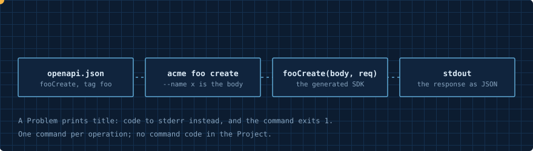

# @n8io/baseline-cli

**Every API operation becomes a command, with no command code of your own.** `cliCreate` reads the Project's OpenAPI document and turns each operation into a command that calls the generated SDK, so `fooCreate` under the tag `foo` is `acme foo create --name x`.

```sh
pnpm add @n8io/baseline-cli
```

<p align="center"></p>

## Guarantees

| You get                             | How                                                                                                                                                                                                                  |
| ----------------------------------- | -------------------------------------------------------------------------------------------------------------------------------------------------------------------------------------------------------------------- |
| **Commands named like the API**     | `<tag> <rest of operationId>` in kebab-case, grouped by tag in `--help`, with each operation's summary and description as its help.                                                                                  |
| **Flags for every field**           | Path, query and JSON body fields become kebab-case flags (`customerId` is `--customer-id`); `--data '<json>'` or `--data @file.json` sends a whole body.                                                             |
| **Output scripts can read**         | A response prints its JSON to stdout. A Problem prints `title: code` to stderr and exits 1, so `&&` and `set -e` stop on it.                                                                                         |
| **Secrets kept off the screen**     | `login` reads the client secret from `<NAME>_CLIENT_SECRET` or stdin, never a flag, and stores the token in the OS config directory with mode 600.                                                                   |
| **A token only where it came from** | The stored login is sent only to the URL it was issued by, and only until it expires; `login` refuses plain `http://` except to this machine.                                                                        |
| **A document it can name**          | `cliCreate` throws at once on an operation without exactly one tag that its operationId starts with, a header or cookie parameter, a name the CLI keeps for itself, or no SDK function, instead of on a user's call. |

## Example

```ts title="clients/cli/cli.ts"
#!/usr/bin/env node
import { cliCreate } from "@n8io/baseline-cli";
import * as sdk from "acme-sdk";
import document from "acme-sdk/openapi.json" with { type: "json" };

const { sdkConfigure: _, ...operations } = sdk;

await cliCreate({ document, name: document.info.title, operations }).run(
	process.argv.slice(2),
);
```

```sh
export ACME_URL=http://localhost:3000
echo "$SECRET" | acme login --client-id ci
acme foo create --name x
```

Test it as its users run it: start the CLI as a child process over a fixture document and fake operations that answer with the arguments they got, and read its stdout, stderr and exit code (`src/cli-create.test.ts`).

## Reference

<details><summary><b>Exports</b></summary>

| Export                                      | Does                                                                                                                                                                                 |
| ------------------------------------------- | ------------------------------------------------------------------------------------------------------------------------------------------------------------------------------------ |
| `cliCreate({ document, name, operations })` | Builds the CLI. `document` is the OpenAPI document; `name` is the command's name and, upper snake cased, its env var prefix; `operations` maps each operationId to its SDK function. |
| `Cli`                                       | `run(argv)` runs one command from the arguments after the script (`process.argv.slice(2)`) and sets `process.exitCode`.                                                              |
| `CliOperation`                              | An SDK function, called as described below.                                                                                                                                          |
| `CliOperationResponse`                      | What an SDK function resolves to: `{ status, data }`.                                                                                                                                |
| `CliRequest`                                | The last argument of every call: `{ baseUrl, token? }`.                                                                                                                              |
| `CliDocument`                               | The parts of an OpenAPI document the CLI reads.                                                                                                                                      |

</details>

<details><summary><b>How a command calls its SDK function</b></summary>

The arguments are, in order:

1. each path field, in the order the path names them;
2. the body, if the operation has one (`undefined` when none is set): `--data` first, then each body flag over it. A `--data` that is not a JSON object (an array, a string) goes as it is, and body flags on top of it exit 1;
3. the query object, if the operation has query fields (`undefined` when none is set);
4. a `CliRequest`, `{ baseUrl, token }`, for the SDK's fetch to read.

The function resolves to `{ status, data }`. A status of 400 or more is a failure: the CLI prints `data.title` and `data.code` to stderr (or `HTTP <status>` and the body when it is not a Problem) and exits 1. Otherwise it prints `data` as JSON, or nothing when there is no body.

</details>

<details><summary><b>Flags and values</b></summary>

- A path field is a required flag. A body field that the schema requires is marked required in its help but may come from `--data` instead.
- `integer` and `number` fields are parsed as numbers; a `boolean` field is `--flag` for true and `--no-flag` for false; an `array` field takes several values (`--ids 4 5`), each parsed by its item type; any other field takes JSON (falling back to the text). A field's type is read through `anyOf` and `oneOf`, so a nullable string stays text, and a string `enum` is text.
- A field's help shows its `description`, its `enum` values and its `default`. A value outside the `enum` exits 1 before any request. The default is only shown: the CLI leaves an unset field out, and the API applies its own default.
- `--url`, `--token`, `--data` and `--help` belong to the CLI, and so do the commands `login` and `help`; `cliCreate` throws on a field or command with one of those names, or on two fields with the same flag. An operation's parameter replaces the path item's one with the same name.
- `$ref`s inside the document are followed.

</details>

<details><summary><b>Base URL, token and login</b></summary>

- The base URL is `--url`, else `<NAME>_URL`. Without one, a command exits 1 and says so.
- The token is `--token`, else `<NAME>_TOKEN`, else the stored login for that base URL.
- `<name> login --client-id <id> [--scope <scopes...>]` posts `grant_type=client_credentials` to `<url>/auth/token`, with the app's `Origin` for its CSRF check. The client secret is `<NAME>_CLIENT_SECRET`, else stdin when it is a shell pipe or a file (`echo "$SECRET" | acme login …`, `acme login … < secret.txt`), else none: the Template's development issuer needs none. The URL must be `https://`, or `http://` to `localhost`, `127.0.0.1` or `[::1]`.
- The login is stored at `$XDG_CONFIG_HOME/<name>/login.json`, else `~/Library/Application Support/<name>/login.json` on macOS, `%APPDATA%\<name>\login.json` on Windows and `~/.config/<name>/login.json` elsewhere: the folder is mode 700 and the file 600, written to a new file and renamed into place.

</details>

**Needs** Node 26 and a generated SDK (the Template's `sdk` piece). Runs on commander, which never appears in its types.
