# @n8io/baseline-error-tracking

**Every error you log becomes an Error report, linked to its trace and never carrying its message**, sent without ever slowing or failing a request.

```sh
pnpm add @n8io/baseline-error-tracking
```

<p align="center"></p>

## Guarantees

| You get                         | How                                                                                                                                                    |
| ------------------------------- | ------------------------------------------------------------------------------------------------------------------------------------------------------ |
| **Report by logging**           | Wired to `loggerErrorListen`, every error logged at error or fatal is reported. Callers keep calling `logger.error`.                                   |
| **No message, ever**            | The report is built from the logger's safe shape: class names, stack frames, cause chain, `code` and `constraint`. The error itself is never sent.     |
| **Linked to its trace**         | Inside an active span, the report carries its trace id and span id.                                                                                    |
| **Never in the way**            | `report` returns at once and never throws. Each send times out after 5 s; `close()` waits about 2 s at most for the reports in flight.                 |
| **Only what a report needs**    | An allowlist drops anything else the SDK adds, such as the host name. Nothing global is installed: no process handler, module hook or tracer provider. |
| **A wrong DSN fails at boot**   | A `dsn` that is not a valid DSN throws, so a typo does not look like a working setup.                                                                  |
| **Swap the vendor in one line** | `ErrorTracking` names no vendor: a new `errorTracking<Vendor>Create` adapter here and one line in the Project, and callers do not change.              |

## Example

```ts
import { errorTrackingSentryCreate } from "@n8io/baseline-error-tracking";
import { loggerErrorListen } from "@n8io/baseline-logger";

// Without SENTRY_DSN, nothing is reported and errors are only logged.
if (ENV.SENTRY_DSN) {
	const errorTracking = errorTrackingSentryCreate({
		dsn: ENV.SENTRY_DSN,
		environment: ENV.APP_ENV,
	});
	const stop = loggerErrorListen((error) => errorTracking.report(error));
	const close = async () => { stop(); await errorTracking.close(); };
	resources.push({ close, name: "error tracking" }); // a shutdown step
}
```

There is no stand-in: with no DSN, the Project skips the connection. Code that reports takes an `ErrorTracking`, so its tests pass one (`report`, `close` and `Symbol.asyncDispose`) that records what it was handed. A test of the wiring points `dsn` at a local HTTP server, as the Template's `src/error-tracking-open.test.ts` does; no account or network needed.

## Reference

<details><summary><b>Exports</b></summary>

| Export                                                                                   | Does                                                                                                                                                                                                                                                                                                                        |
| ---------------------------------------------------------------------------------------- | --------------------------------------------------------------------------------------------------------------------------------------------------------------------------------------------------------------------------------------------------------------------------------------------------------------------------- |
| `ErrorTracking`                                                                          | `report(error)` and `close()`; `await using` calls `close()` when its block ends. `report` never throws: a report that cannot be sent is dropped, and one Sentry refuses is logged at warn. Nothing is sent after `close()`.                                                                                                |
| `errorTrackingSentryCreate({ dsn, environment, vendor? })`, `ErrorTrackingSentryOptions` | Reports to Sentry's ingestion API with `@sentry/core`'s `ServerRuntimeClient` and `fetch`, with a 5 s timeout per send. It throws on a `dsn` that is not a Sentry DSN. The report is built from `loggerErrSerialize`, the logger's safe shape; `code` and `constraint` become the `error.code` and `error.constraint` tags. |
| `ErrorTrackingSentryVendorOptions`                                                       | `vendor`: Sentry's own `release`, `dist` and `sampleRate`, outside the contract. Any other key throws: it would do nothing here, or send more than an Error report carries.                                                                                                                                                 |
</details>

<details><summary><b>Why not <code>@sentry/node</code></b></summary>

`@sentry/node` depends on `@sentry/bundler-plugins`, which installs the Sentry CLI (licensed FSL-1.1-Apache-2.0, 22 MB, with a native parser) in every production install, and installs module hooks that `@n8io/baseline-telemetry` already owns. `@sentry/core` is MIT, Sentry's own, and is what `@sentry/node` is built on.
</details>

<details><summary><b>In the Template</b></summary>

`src/error-tracking-open.ts` does the wiring in the Example and, with a DSN, adds a shutdown step named `error tracking`. `SENTRY_DSN` is optional: without it, nothing is reported, and errors are still logged. `pnpm piece-remove error-tracking` deletes the piece.
</details>

**Needs** `@opentelemetry/api` as a peer, a DSN (the Template reads `SENTRY_DSN`), and `LOG_LEVEL` at `error` or below when reports come through `loggerErrorListen`: a level the logger turns off reaches no listener. Runs on Sentry.
