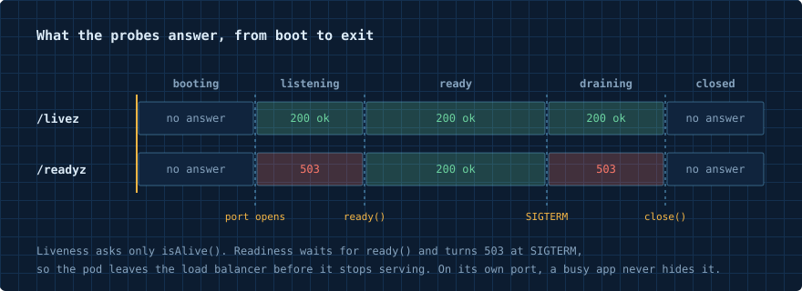

# @n8io/baseline-health

**Probes that tell the truth about a process**: `/livez` and `/readyz` on their own port, so a busy or draining app server never hides them, and readiness turns 503 the moment shutdown starts.

```sh
pnpm add @n8io/baseline-health
```

<p align="center"></p>

## Guarantees

| You get                                     | How                                                                                                                                                                      |
| ------------------------------------------- | ------------------------------------------------------------------------------------------------------------------------------------------------------------------------ |
| **Never ready too early**                   | `/readyz` is 503 until you call `ready()`, once every intake listens.                                                                                                    |
| **Out of rotation before it stops serving** | `/readyz` is 503 again as soon as `isShuttingDown()` is true, while open requests still finish.                                                                          |
| **Liveness you decide**                     | `/livez` asks only your `isAlive()`, so a database outage restarts nothing unless you say so.                                                                            |
| **Its own port**                            | Plain `node:http`, apart from the app's server: a slow route or a saturated app server never hides a probe. It shares the event loop, so CPU-bound work still delays it. |
| **No false probe failures**                 | Idle probe connections stay open 65 s, longer than a load balancer keeps its own, so a check never lands on a connection the server has closed.                          |
| **A quick close**                           | `close()` drops open connections instead of waiting out keep-alive, and `await using` calls it.                                                                          |

## Example

```ts
import { healthServerCreate } from "@n8io/baseline-health";
import type { ShutdownHandle } from "@n8io/baseline-shutdown";

let shutdown: ShutdownHandle | undefined; // set once every intake listens
const health = healthServerCreate({
	isAlive: () => queue.isAlive(),
	isShuttingDown: () => shutdown?.isShuttingDown() ?? false,
	port: ENV.HEALTH_PORT,
});

// Once every intake listens, open the shutdown handle, then:
health.ready();
```

List `{ close: () => health.close(), name: "health" }` among the shutdown handle's resources, so the probes close on shutdown after the connections.

Test it the way a probe sees it: pick a free port, pass it, and `fetch` `/livez` and `/readyz` (retry the first fetch: `listen` is asynchronous). No mocks needed.

## Reference

<details><summary><b>Exports</b></summary>

| Export                                                  | Does                                                                                                                                                                                   |
| ------------------------------------------------------- | -------------------------------------------------------------------------------------------------------------------------------------------------------------------------------------- |
| `healthServerCreate({ port, isAlive, isShuttingDown })` | Serves `/livez` and `/readyz` on plain `node:http` and starts listening. Bodies are `ok` (200) or `unavailable` (503), `text/plain`; any other path is 404. A query string is ignored. |
| `HealthServerOptions`                                   | What `healthServerCreate` takes: `port`, `isAlive()`, `isShuttingDown()`.                                                                                                              |
| `HealthServer`                                          | `ready()` marks the process ready. `close()` stops listening and drops every open connection; `await using` calls it when its block ends.                                              |

- `/livez` is 200 while `isAlive()` is true.
- `/readyz` is 503 until `ready()`, and again once `isShuttingDown()` is true.
</details>

<details><summary><b>In the Template</b></summary>

- The Server and the Worker open the health port only after their connections open, so a process that cannot reach the database exits at boot and never answers a probe: a rollout stalls with the old pods still serving.
- The Server's `isAlive()` is always true; the Worker's is false only when its own poll loops hang (60 s), which a restart fixes. A database outage never fails liveness.
- The Server calls `ready()` once its port is bound, the Worker once its Event handlers and Schedules start. On SIGTERM `/readyz` turns 503 and the Server keeps serving for the drain delay while the balancer drops it, then closes. Health closes after the connections and before telemetry.
- Probe settings for Kubernetes are in the Template's `docs/agents/deploy-kubernetes.md`.
</details>

**Needs** nothing: no peers and no env. The Template's convention is `HEALTH_PORT` (default 9000).
