# @n8io/baseline-id

**Ids you can read, that sort by time and carry their type.** Prefixed [TypeIDs](https://github.com/jetify-com/typeid) (`foo_01h455vb4pex5vsknk084sn02q`) backed by UUIDv7, typed by their prefix, and stored as a plain Postgres `uuid`.

```sh
pnpm add @n8io/baseline-id
```

<p align="center"></p>

## Guarantees

| You get                                   | How                                                                                                                  |
| ----------------------------------------- | -------------------------------------------------------------------------------------------------------------------- |
| **Ids that say what they are**            | `foo_…`: a snake_case prefix, then the UUID in 26 characters of base32.                                              |
| **A `bar` id never passes as a `foo` id** | `Id<"foo">` types an id by its prefix, and `idPatternCreate("foo")` matches exactly that prefix at runtime.          |
| **Sorted by when they were made**         | The UUID inside is a UUIDv7: its first 48 bits are the time in milliseconds, so ids sort by time to the millisecond. |
| **16 bytes in the database**              | `idToUuid` and `idFromUuid` convert to and from a plain `uuid` column.                                               |
| **Bad input fails loudly**                | A bad prefix, id or UUID throws a `TypeError`.                                                                       |
| **Any schema library**                    | The Package imports none; build your id schema from the pattern.                                                     |

## Example

```ts
import {
	type Id,
	idCreate,
	idFromUuid,
	idPatternCreate,
	idToUuid,
} from "@n8io/baseline-id";

const fooId: Id<"foo"> = idCreate("foo");
idPatternCreate("foo").test(fooId); // true

const uuid = idToUuid(fooId); // "01a1…" for the database
idFromUuid("foo", uuid) === fooId; // true
```

In tests, make ids with `idCreate`: they need no fake, and each one is new.

## Reference

<details><summary><b>Exports</b></summary>

| Export                     | Does                                                                                                             |
| -------------------------- | ---------------------------------------------------------------------------------------------------------------- |
| `Id<P>`                    | The type of an id with prefix `P`, so a `bar` id never passes as a `foo` id.                                     |
| `idCreate(prefix)`         | A new id with a time-ordered UUIDv7 inside.                                                                      |
| `idPatternCreate(prefix)`  | A `RegExp` that matches only ids with exactly that prefix. Give it to your schema library to build an id schema. |
| `idToUuid(id)`             | The bare UUID, for a `uuid` column.                                                                              |
| `idFromUuid(prefix, uuid)` | The id back from a UUID.                                                                                         |

Prefixes are snake_case. A bad prefix, id or UUID throws a `TypeError`.

</details>

<details><summary><b>An id schema with Zod</b></summary>

The Package imports no schema library, so build the schema in yours from the pattern. With Zod, as the Template's `src/id-schema.ts` does:

```ts
import { type Id, idPatternCreate } from "@n8io/baseline-id";
import { z } from "zod";

export const idSchemaCreate = <P extends string>(prefix: P): z.ZodType<Id<P>> =>
	z
		.string()
		.regex(idPatternCreate(prefix), `Expected a ${prefix} id`) as z.ZodType<
		Id<P>
	>;

const FooParams = z.object({ fooId: idSchemaCreate("foo") });
FooParams.parse({ fooId }); // { fooId: Id<"foo"> }
```

The pattern also shows up in an OpenAPI document generated from the schema.

</details>

<details><summary><b>Mutation score</b></summary>

`pnpm test:mutation` runs [Stryker](https://stryker-mutator.io) over `src/id.ts` with the Package's tests and fails below a **floor of 90%**. The score today is 95.4% (81 killed, 2 timed out, 4 survived of 87 mutants). The survivors are the unanchored UUID pattern (`^` and `$` are untested on a UUID with text around it) and the two `?? 0` fallbacks on bytes that are always set. Raise the floor as tests kill them; never lower it to pass. It is not in CI yet.

</details>

**Needs** nothing: no peers and no env.
