# @n8io/baseline-live

**Every open page reruns its loaders when something it shows changes.** The Server sends a Live update over Server-Sent Events, it fans out to every instance through pub/sub, and a lost one never fails the change that caused it.

```sh
pnpm add @n8io/baseline-live
```

<p align="center"></p>

## Guarantees

| You get                                    | How                                                                                                                                                                             |
| ------------------------------------------ | ------------------------------------------------------------------------------------------------------------------------------------------------------------------------------- |
| **Every instance, every page**             | `liveHubRedisCreate` fans each update out through pub/sub to every instance; each open stream for that (channel, id) passes it to its page.                                     |
| **No data on the wire**                    | An update says what changed (`{ type, id }`), never the data. The page rereads through its own loaders.                                                                         |
| **A change never fails for a Live update** | `send` never rejects: when the hub's connection fails or does not answer within 1 s it resolves, counts the loss on `baseline.live.sends_failed` and logs one warning per 30 s. |
| **Pages catch up after an outage**         | When the hub's subscriber connection comes back, every stream it holds sends `ready` again, spread over 1 to 5 s, and each page reruns its loaders. No reload.                  |
| **Streams that end on time**               | A stream closes after 5 minutes, at `expiresAt` if sooner, or on `liveHub.close()`, and asks the page to reconnect within 1 to 5 s, so a wave of reconnects is spread out.      |
| **A slow page never slows the rest**       | A page that stops reading is dropped once 64 KiB waits for it; it reconnects and revalidates.                                                                                   |
| **One hook on the page**                   | `useLiveUpdates` revalidates on each update, on every reconnect and on every `ready`.                                                                                           |

## Example

```ts
import { liveStreamCreate } from "@n8io/baseline-live";
// Server: a route that streams one foo's updates (Hono here; any web Response works).
app.get("/live/foo/:fooId", (c) => {
	const live = liveStreamCreate({
		channel: "foo",
		expiresAt: c.var.authnExpiresAt ?? Number.POSITIVE_INFINITY,
		id: c.req.param("fooId"),
		liveHub,
		signal: c.req.raw.signal,
	});
	return c.newResponse(live.body, live); // keeps headers that middleware set
});

// After a change commits. No catch: a send never rejects.
await liveHub.send("foo", { id: foo.id, type: "foo.updated" });
```

```tsx
// Page: rerun this route's loaders when the foo changes.
import { useLiveUpdates } from "@n8io/baseline-live/client";

useLiveUpdates({ channel: "foo", id: foo.id });
```

Test with the memory hub, `liveHubMemoryCreate()`, and read a stream with `liveTestSseRead` from `@n8io/baseline-live/testing` (see Testing below). The Package's own `pnpm test` needs Docker for Redis; `pnpm test:unit` runs the tests that need no Redis.

## Reference

<details><summary><b>Exports</b></summary>

| Export                                                                       | Does                                                                                                                                                                                                                                                                                                                                                                                                                                                                                                             |
| ---------------------------------------------------------------------------- | ---------------------------------------------------------------------------------------------------------------------------------------------------------------------------------------------------------------------------------------------------------------------------------------------------------------------------------------------------------------------------------------------------------------------------------------------------------------------------------------------------------------- |
| `LiveHub`                                                                    | `send(channel, update)` and `close()`. `send` is best effort and never rejects: see When Redis is down. `close()` ends every open stream, each asking its page to reconnect. `await using` calls `close()` when its block ends.                                                                                                                                                                                                                                                                                  |
| `LiveUpdate`                                                                 | What `send` takes, `{ type, id }`: what changed, never the data.                                                                                                                                                                                                                                                                                                                                                                                                                                                 |
| `liveHubRedisCreate({ redisClient })`                                        | A hub on Redis pub/sub, for more than one instance. It takes any connected node-redis client, such as one from `redisClientCreate` in `@n8io/baseline-redis`.                                                                                                                                                                                                                                                                                                                                                    |
| `LiveHubRedisOptions`                                                        | What `liveHubRedisCreate` takes.                                                                                                                                                                                                                                                                                                                                                                                                                                                                                 |
| `liveHubMemoryCreate()`                                                      | A hub in one process, for unit tests and `memory://`.                                                                                                                                                                                                                                                                                                                                                                                                                                                            |
| `liveStreamCreate({ liveHub, channel, id, expiresAt, signal? })`             | The SSE `Response` for one (channel, id), for any server that answers with a web `Response`. Throws `TypeError` on an `expiresAt` that is not a number and on a `liveHub` from another factory. Pass the request's `signal`. It sends `ready` once subscribed, and again when the hub may have lost updates. It sends a comment every 20 s to keep the connection open. It closes after 5 minutes, at `expiresAt` (epoch ms) if sooner, or on `liveHub.close()`, and asks the page to reconnect within 1 to 5 s. |
| `LiveStreamOptions`                                                          | What `liveStreamCreate` takes.                                                                                                                                                                                                                                                                                                                                                                                                                                                                                   |
| `@n8io/baseline-live/client`: `useLiveUpdates({ channel, id, pathPrefix? })` | A React hook that revalidates the page on each update, on every reconnect and on every `ready`. It opens `<pathPrefix>/<channel>/<id>`; an `id` of `null` opens no stream, so a page can follow an id it does not have yet; `pathPrefix` defaults to `/live`, so pass it when the Server mounts the streams elsewhere.                                                                                                                                                                                           |
| `@n8io/baseline-live/client`: `LiveUpdatesOptions`                           | What `useLiveUpdates` takes.                                                                                                                                                                                                                                                                                                                                                                                                                                                                                     |
| `@n8io/baseline-live/testing`: `liveTestSseRead({ response })`               | Reads a live stream in a test, as a `LiveTestSseReader`. See Testing.                                                                                                                                                                                                                                                                                                                                                                                                                                            |
| `@n8io/baseline-live/testing`: `LiveTestSseReadOptions`                      | What `liveTestSseRead` takes.                                                                                                                                                                                                                                                                                                                                                                                                                                                                                    |
| `@n8io/baseline-live/testing`: `LiveTestSseReader`                           | What `liveTestSseRead` returns: `until(text)`, `end()` and `cancel()`.                                                                                                                                                                                                                                                                                                                                                                                                                                           |

</details>

<details><summary><b>Picking the hub in one place</b></summary>

Pick the hub in one place, and name no backend anywhere else:

```ts
// src/live-hub-open.ts: the only file that knows the backend
import {
	type LiveHub,
	liveHubMemoryCreate,
	liveHubRedisCreate,
} from "@n8io/baseline-live";
import type { RedisClient } from "@n8io/baseline-redis";

export const liveHubOpen = ({
	redis,
}: {
	redis: RedisClient | "memory";
}): LiveHub =>
	redis === "memory"
		? liveHubMemoryCreate()
		: liveHubRedisCreate({ redisClient: redis });
```

</details>

<details><summary><b>When Redis is down</b></summary>

A Live update is a hint to reread, not data, so losing one never fails the change that caused it:

- `send` resolves when Redis fails or does not answer within 1 s. Each lost update is counted on `baseline.live.sends_failed` (by `baseline.live.channel`), and logged as one warning per 30 s per hub.
- Redis pub/sub does not replay what a subscriber missed. When a hub's subscriber connection comes back, every stream it holds sends `ready` again, spread over 1 to 5 s, and each page reruns its loaders. So a page is stale for the length of the outage and then catches up, without a reload.

</details>

<details><summary><b>Testing</b></summary>

Test code that sends Live updates with the memory hub, and read a stream with `liveTestSseRead` from `@n8io/baseline-live/testing`. Import it from test files only.

```ts
import { liveHubMemoryCreate, liveStreamCreate } from "@n8io/baseline-live";
import { liveTestSseRead } from "@n8io/baseline-live/testing";

await using liveHub = liveHubMemoryCreate();
const response = liveStreamCreate({
	channel: "invoice",
	expiresAt: Number.POSITIVE_INFINITY,
	id: "invoice_1",
	liveHub,
});
const sse = liveTestSseRead({ response });
await sse.until("event: ready");

await liveHub.send("invoice", { id: "invoice_1", type: "invoice.updated" });

expect(await sse.until("invoice.updated")).toContain(
	'data: {"id":"invoice_1","type":"invoice.updated"}',
);
```

- `until(text)` resolves with everything read once it holds `text`, and throws when the stream ends first.
- `end()` resolves with everything read once the Server ends the stream.
- `cancel()` goes away like a page that closes.

`response` is any SSE `Response`: the one `liveStreamCreate` returns, your Project's `app.request(...)`, or a `fetch` of a running server.

</details>

**Needs** `@opentelemetry/api` as a peer, for the counter (it does nothing until your Project registers a meter provider); for the Redis hub, a connected node-redis client you pass in (such as `@n8io/baseline-redis`'s), so the Package needs no `redis` of its own, and `CACHE_URL` by the Template's convention (the hub shares the cache's connection); `react` and `react-router` only for `@n8io/baseline-live/client`, so a service that only sends or streams updates installs neither. Runs on Redis pub/sub and Server-Sent Events.
