# @n8io/baseline-logger

**One logger that cannot leak**: JSON to stdout, credentials redacted, and an error logged only as its class, code and stack frames, never its message.

```sh
pnpm add @n8io/baseline-logger
```

<p align="center"></p>

## Guarantees

| You get                             | How                                                                                                                                                    |
| ----------------------------------- | ------------------------------------------------------------------------------------------------------------------------------------------------------ |
| **One logger everywhere**           | Every app and Package imports the same `logger`, typed as this Package's own `Logger`, so the library behind it can change without touching a caller.  |
| **Credentials never logged**        | Fields named like credentials (`authorization`, `cookie`, `password`, `token` and others) log as `[Redacted]`, also one level down and in headers.     |
| **No message text**                 | An error leaves only as its class name, `code`, `constraint` and stack frames, down the `cause` chain. With no message given, `msg` is the class name. |
| **Errors reach error tracking**     | `loggerErrorListen` hears each error logged at error or fatal, inside the log call, so it sees the caller's trace.                                     |
| **A listener cannot break logging** | A listener that throws is skipped and the line still goes out; an error a listener logs is not heard again.                                            |
| **Logs join the trace**             | With `@n8io/baseline-telemetry` preloaded, each record also goes out as an OTLP log with the active trace id.                                          |

## Example

```ts
import { logger } from "@n8io/baseline-logger";

logger.info({ port }, "Server listening");
logger.error({ err: error }, "Postgres idle client error");
// An err with no message logs its class name as msg, never error.message.
logger.error({ err: error });
```

Tests read what was logged with `vi.spyOn(logger, "warn")`; nothing to configure.

## Reference

<details><summary><b>Exports</b></summary>

| Export                                                      | Does                                                                                                                                                                                                                                                                                                                                                                                                                                                                                                              |
| ----------------------------------------------------------- | ----------------------------------------------------------------------------------------------------------------------------------------------------------------------------------------------------------------------------------------------------------------------------------------------------------------------------------------------------------------------------------------------------------------------------------------------------------------------------------------------------------------- |
| `logger`                                                    | The one logger: `fatal`, `error`, `warn`, `info`, `debug`, `trace` and `level`. Credential fields are redacted as above.                                                                                                                                                                                                                                                                                                                                                                                          |
| `Logger`, `LoggerMethod`                                    | The types of `logger` and of one level's call, `(fields, message?)` or `(message)`. There is no `child`, no printf-style arguments and no way to set `level`; the level comes from `LOG_LEVEL`.                                                                                                                                                                                                                                                                                                                   |
| `loggerErrorListen(listener)`, `LoggerErrorListener`        | Calls `listener` with each error logged at error or fatal (an `err` field, or an Error passed first), inside the log call, so it sees the caller's active trace; returns a function that stops it. A listener that throws is skipped and the log line still goes out, and an error a listener logs is not heard again. Listeners live on `globalThis`, so two copies of this Package share them. A level that `LOG_LEVEL` turns off reaches no listener. `@n8io/baseline-error-tracking` reports errors this way. |
| `loggerErrSerialize(value)`, `LoggerErr` (`/err-serialize`) | The safe shape. An error leaves the process only as its class name, `code`, `constraint` and stack, down the `cause` chain (10 deep at most); never its message, which can hold input text. `logger` uses it for every `err`, and telemetry and error tracking build on it.                                                                                                                                                                                                                                       |
</details>

**Needs** `LOG_LEVEL` (`fatal`, `error`, `warn`, `info`, `debug`, `trace` or `silent`; default `info`). Runs on pino; nothing in the API names it.
