# @n8io/baseline-queue

**Events, Event handlers and Schedules in your app's own Postgres.** An Event commits or rolls back with the rows that caused it, Events with the same Event key reach each Event handler in order, and an Inbox skips an Event that is delivered twice.

```sh
pnpm add @n8io/baseline-queue
```

<p align="center"></p>

## Guarantees

| You get                              | How                                                                                                                                                                                                                                                       |
| ------------------------------------ | --------------------------------------------------------------------------------------------------------------------------------------------------------------------------------------------------------------------------------------------------------- |
| **Committed with the write**         | A publish writes the Event on the caller's transaction (an outbox). A rollback drops it with the rows.                                                                                                                                                    |
| **In order per Event key**           | A publish locks its key until its transaction ends; each Event handler gets one Event of a key at a time, in commit order, on any number of workers.                                                                                                      |
| **Parallel across keys**             | Events of different keys run beside each other. Measured once: 12 workers drain about 1,000 Events a second over 50 keys.                                                                                                                                 |
| **Handled once**                     | `queueInboxInsert` records the Event in the caller's transaction and returns `false` for a repeat. The worker prunes old Inbox rows daily.                                                                                                                |
| **A loud stop, never a silent skip** | Five attempts with backoff, then a copy in `<queueName>.dead`, the key held back, an error that reaches error tracking every day it stays blocked, gauges for how many, how old and how much waits, and an error if the queue ever deletes it unreleased. |
| **Schedules that survive rollouts**  | Synced from the migrate entry, started in the worker, one run per tick however many workers. `SCHEDULE_<NAME>` overrides a cron or turns it `off`.                                                                                                        |
| **One trace**                        | An Event handler runs in the trace of the request that published its Event.                                                                                                                                                                               |
| **Any schema**                       | A Zod, Valibot or ArkType schema as it is: anything that implements Standard Schema. A failure names the paths, never the values.                                                                                                                         |
| **Liveness that outlasts an outage** | `isAlive()` fails only when the poll loop hangs for 60 s, so a Postgres outage never fails liveness, given a pool query timeout under 60 s.                                                                                                               |

<p align="center"></p>

## Example

```ts
// In the billing context's HTTP route: validate with the schema, then call the Use case.
export const billingOrderPlaced = queueConsumerCreate({
	eventName: "order.placed",
	queueName: "billing.order-placed", // <consumer domain>.<event>
	run: (event, inbox) =>
		billingUseCases.invoiceCreate(actor, {
			amountCents: event.totalCents,
			inbox,
		}),
	schema: z.object({ totalCents: z.number().int() }),
});
// In the worker. A server opens the queue as a "publisher" and calls consumersSubscribe.
const queue = await queueCreate({ pgPool, role: "worker" });
const events = queueEventsCreate(queue);
await events.consumersStart([billingOrderPlaced]);
```

Publish in the transaction that makes the change, after the write, and call `committed()` once it commits:

```ts
// In a context's transaction port, on the transaction's client.
const publisher = events.publisherCreate(pgClient);
await publisher.publish({
	data: { totalCents },
	key: order.id,
	name: "order.placed",
});
await publisher.committed(); // after COMMIT; on a rollback, discard the publisher
```

Test an Event handler the way the worker runs it, with no queue running: `queueTestConsumerRun` from `@n8io/baseline-queue/testing` validates the data with its schema and passes an Inbox. Unit-test code that publishes with `queueEventsMemoryCreate()`, an `EventsPublisher` that records each publish.

```ts
import { queueTestConsumerRun } from "@n8io/baseline-queue/testing";

const result = await queueTestConsumerRun({
	consumer: billingOrderPlaced,
	data: { totalCents: 1200 },
});
```

## Reference

<details><summary><b>Exports</b></summary>

- `queueMigrate({ databaseUrl, queuesRemoved?, vendor? })` (`vendor`, typed `QueueMigrateVendorOptions`, takes `ssl`, `application_name` and `options` for the connection pg-boss opens to migrate): installs or upgrades the queue's tables in schema `queue` and creates `queue.inbox`. It also removes the queues an upgrade left behind (see Upgrading to 8, under Reference). Run it from the migrate entry.
- `queueCreate({ pgPool, role, concurrency?, vendor? })`, `Queue`: starts the queue on the shared pool. A `"publisher"` (the server) only sends; a `"worker"` also runs maintenance, cron and Inbox pruning. `concurrency` is how many Events and Schedule runs a worker has under way at once, across all its Event handlers and Schedules (default 4); keep it below the pool's size, since each holds a connection while it runs. `isAlive()` feeds `/livez` (see Health, under Reference); `blockedKeys()` lists the Event keys an Event that failed for good holds back, as `{ consumer, key, since, deleteAt }`, and `blockedKeyRetry({ consumer, key })` and `blockedKeyGiveUp({ consumer, key })` release one (see Runbook: a blocked key, under Reference); `stop()` waits up to 15 s for running jobs, and `await using` calls it when its block ends. `vendor` (typed `QueueVendorOptions`) takes pg-boss's own intervals, warnings and retention settings and passes them through. It throws on the keys `queueCreate` sets itself (`db`, `schema`, `migrate`, `schedule`, `supervise`, `openTelemetry`), on connection settings (the queue runs on your pool, so set them there), and on the ones that only act in `queueMigrate` or that the queue does not support. It is outside the contract: nothing in it is tested here, and moving off pg-boss deletes it.
- `Events`: how Events travel, whatever carries them: `consumersSubscribe(consumers)` (every process that publishes calls it at boot), `consumersStart(consumers)` (worker only), `publisherCreate(transaction)` and `isAlive()`. A composition root opens one and nothing else names the transport.
- `EventsPublisher`: one per transaction. `publish({ name, data, key })` inside it, then `committed()` once it has committed; on a rollback, discard it. `key` is the Event key: the id of the entity the Event is about, never empty (see Order, under Reference).
- `queueEventsCreate(queue)`: `Events` on the queue. A publish writes on the transaction's client (an outbox), so `committed()` has nothing left to do.
- `queueEventsMemoryCreate({ published? })`: an `EventsPublisher` that records each publish in the `published` array as `{ name, data, key }`, for unit tests. The argument is optional.
- `queueConsumerCreate({ queueName, eventName, schema, run })`, `Consumer`: validates each Event with the schema and calls `run` with its output. `schema` is any [Standard Schema](https://standardschema.dev): a Zod, Valibot or ArkType schema goes in as it is. An Event that fails throws, which fails the job; the error names the paths that failed (a record's keys included) and never the validator's message, which may repeat the Event's values.
- `@n8io/baseline-queue/testing`: `queueTestConsumerRun({ consumer, data, eventId? })` runs one Event through an Event handler as the worker does (validated by its schema, with an Inbox of its `queueName` and the `eventId`, a new one by default) and returns the Event handler's result. Import it from test files only.
- `queueScheduleCreate({ name, cron, run })`, `Schedule`: a UTC cron Schedule. `queueSchedulesSync({ databaseUrl, schedules, env, vendor? })` writes the Schedules to the database from the migrate entry, and `queueSchedulesStart({ queue, schedules, env })` runs them in the worker (see Schedules, under Reference). `SCHEDULE_<NAME>` overrides a cron, or turns it `off`.
- `queueInboxInsert(transaction, inbox)`, `Inbox`: records the Event as handled in the caller's transaction; `false` means it was already handled.
- `QueueSql`: anything with `query(text, values?)` on the Project's Postgres, such as a node-postgres pool or a transaction's client. `queueCreate`, `publisherCreate` and `queueInboxInsert` take it, so the Package needs no `pg` types.

</details>

<details><summary><b>A whole worker, with a Schedule</b></summary>

```ts
import type { Actor } from "@n8io/baseline-authn";
import { z } from "zod";
import {
	queueConsumerCreate,
	queueCreate,
	queueEventsCreate,
	queueScheduleCreate,
	queueSchedulesStart,
} from "@n8io/baseline-queue";

// The Event's schema, in the publishing context's Published language. Here it is Zod.
const orderPlaced = z.object({
	customerId: z.string(),
	totalCents: z.number().int(),
});

// The worker's composition root.
const queue = await queueCreate({ pgPool, role: "worker" });

// Each Event handler calls its Use case as its own machine Actor.
const billingOrderPlacedHandlerActor: Actor = {
	id: "billing-order-placed-consumer",
	kind: "client",
	scopes: ["billing:invoice-create"],
};
const billingOrderPlaced = queueConsumerCreate({
	eventName: "order.placed",
	queueName: "billing.order-placed", // <consumer domain>.<event>
	run: (event, inbox) =>
		billingUseCases.invoiceCreate(billingOrderPlacedHandlerActor, {
			amountCents: event.totalCents,
			customerId: event.customerId,
			inbox,
		}),
	schema: orderPlaced, // the Zod schema; `event` above is its output type
});
const events = queueEventsCreate(queue);
await events.consumersStart([billingOrderPlaced]);

const fooStaleArchive = queueScheduleCreate({
	cron: "0 3 * * *",
	name: "foo.stale-archive",
	run: () => fooUseCases.fooStaleArchive(fooScheduleActor),
});
// The migrate entry has synced it: queueSchedulesSync({ databaseUrl, env: ENV, schedules: [fooStaleArchive] }).
await queueSchedulesStart({ env: ENV, queue, schedules: [fooStaleArchive] });
```

</details>

<details><summary><b>Order</b></summary>

Every publish names an Event key: the id of the entity the Event is about. Each Event handler gets the Events of one Event key one at a time, in the order their transactions committed, on any number of workers. Events of different Event keys run beside each other. Below, "key" means the Event key.

- **At publish.** A publish locks its key until its transaction ends, so two transactions never publish for one key at once, and the Event is stamped while the lock is held. Publish after the write the Event is about. A transaction that publishes for several keys should always take them in the same order.
- **At the Event handler.** A worker fetches up to 10 Events at a time per Event handler, each of another key, runs up to `concurrency` of them at once, counted across all its Event handlers and Schedules (4 unless `queueCreate` says otherwise; a fetch takes no more than that) and settles each as it ends, so another worker can take that key's next Event at once; the same worker fetches again when its slowest Event of the fetch ends. While an Event waits for its retry, the later Events of its key wait behind it; other keys carry on. A worker that dies mid-Event is noticed within 30 to 90 s. A fetch still running after five minutes has its unfinished Events failed and retried, so keep an Event handler well under that.
- **Throughput.** Measured once on a development machine against one Postgres 18, with an Event handler that writes one row: 12 workers drain 2,000 waiting Events over 50 keys at about 1,000 a second, and a single busy key drains at about 150 Events a second, on 1 worker or 12. The package's tests hold the single key to 20 a second.
- **Traces.** An Event handler runs in the trace of the request that published its Event, also when one fetch brings several. In such a fetch the Event handler has no span of its own: its spans hang off the publishing request's, and an `err` result marks no span.

</details>

<details><summary><b>Runbook: a blocked key</b></summary>

<p align="center"></p>

An Event that fails all five attempts stays in its queue as failed, and a copy goes to `<queueName>.dead`. Strict order means the later Events of that key now wait until someone decides; every other key carries on. The worker logs it at error level ("its key is blocked until released") with the queue and the key, and counts it on `baseline.queue.dead_letters`. An Event the queue fails itself (a dead worker or a fetch out of time, five times over) blocks its key without that log line or count. So every worker also looks once a minute, and per Event handler (`messaging.destination.name`):

- It logs each blocked key at error level ("Event key is blocked until released") with the queue, the key, `since` and `deleteAt`, and again every 24 hours while it stays blocked. The log carries a `QueueBlockedKeyError` whose message names the Event handler but never a key or Event data, so error tracking groups blocked keys instead of opening one issue per key.
- It sets three gauges: `baseline.queue.blocked_keys` (how many keys), `baseline.queue.blocked_key_age` (seconds since the oldest one failed) and `baseline.queue.blocked_key_waiting` (Events waiting behind them). Each is back at 0 once nothing is blocked. Every worker reports the same values, so alert on their maximum across workers, not on a sum.

Decide within 7 days, the queue's deletion time. From `deleteAt` (`since` plus that time) the queue's next sweep, at most a day later, deletes the failed Event, and the key moves on without it. It is never silent: from 24 hours before `deleteAt` each worker warns, and once the Event is gone it logs at error ("Blocked Event was deleted unreleased; its key moved on without it", a `QueueBlockedKeyExpiredError`) and adds to the counter `baseline.queue.blocked_keys_expired`. A key released with the methods below logs neither, except a give-up after `deleteAt`, which looks the same as the sweep. A worker keeps what it has seen in memory, so a deletion while no worker that saw the key is running goes unreported.

List what is blocked with `queue.blockedKeys()`. Then release the key one of two ways, with the Event handler's `queueName` and the key as `blockedKeys()` gives them. Each resolves `true` when it released the key and `false` when that Event handler has no blocked Event for that key. Both work on a `"publisher"` Queue, so a script or an admin route can call them without a Worker.

- `queue.blockedKeyRetry({ consumer, key })` runs the Event again, once the cause is fixed and deployed. It runs before the Events waiting behind it.
- `queue.blockedKeyGiveUp({ consumer, key })` gives the Event up, so the key moves on without it. The copy in `<queueName>.dead` stays for the record; redriving that copy later runs the Event after the ones that were waiting behind it.

In a Project made from the Template, run them in a pod, as the migrate entry runs: `node src/blocked-keys.ts` lists, `node src/blocked-keys.ts retry <consumer> <key>` and `node src/blocked-keys.ts give-up <consumer> <key>` release, and it exits 1 when nothing was released. Locally it is `pnpm blocked-keys`.

When only psql is at hand, the same in SQL. The queue's name is the Event handler's `queueName` plus `.ordered`:

```sql
SELECT name, singleton_key AS key, completed_on AS since,
  completed_on + deletion_seconds * interval '1s' AS delete_at
FROM queue.job WHERE policy = 'key_strict_fifo' AND state = 'failed';
```

```sql
UPDATE queue.job
SET state = 'retry', retry_limit = retry_limit + 1, completed_on = NULL, start_after = now()
WHERE name = 'billing.order-placed.ordered' AND singleton_key = 'order_123' AND state = 'failed';
```

```sql
DELETE FROM queue.job
WHERE name = 'billing.order-placed.ordered' AND singleton_key = 'order_123' AND state = 'failed';
```

</details>

<details><summary><b>Schedules</b></summary>

A Schedule has two halves, in two processes:

- **When it runs** lives in the database. `queueSchedulesSync` makes the database match the list it is given: it adds each Schedule, updates a changed cron, and removes one that is no longer listed or is turned `off`. Call it from the migrate entry, after `queueMigrate`. Migrate runs once per rollout with the newest code, so the list in the database is always the newest version's. It needs only each Schedule's `name` and `cron`.
- **What it runs** lives in the worker. `queueSchedulesStart` starts a worker for each Schedule the database holds and changes nothing there. During a rollout a worker of the previous version may boot late; it cannot remove a Schedule only the new version has, or put an old cron back. A Schedule the database does not hold is not started, and the worker logs a warning ("Schedule is not in the database"): run migrate.

The `SCHEDULE_<NAME>` overrides act where the sync runs, so set them in the environment the migrate entry gets; the worker reads only `off`, to skip a Schedule without a warning. Every cron is validated before the sync changes anything; a bad one fails migrate and names the Schedule or its `SCHEDULE_<NAME>` variable. Each tick runs once, on one worker, however many workers there are.

</details>

<details><summary><b>Health</b></summary>

`queue.isAlive()` answers one question: is this process's poll loop still turning? A worker polls every 2 s. Each poll that ends, in a fetch or in an error, counts. Only when no poll has ended for 60 s is the worker reported dead, which means the loop itself hangs and a restart is the fix.

So a Postgres outage or failover never fails liveness, as long as a poll fails instead of hanging: give the pool a query timeout well under 60 s (`postgresPoolCreate` sets 15 s). Polls fail, the failures of each queue are logged as "Queue error" once per 30 s, and the worker stays up and carries on by itself when Postgres is back. A dependency being down belongs to the startup check: a process that cannot reach Postgres fails `queueCreate` and never reports ready. A publisher has no poll loop and is always alive.

The queue reports a failed poll as a plain object; the Package logs it as an `Error` with the same message, stack and `code`, and that object as its `cause`. When `queueMigrate` removes a queue that a running worker still polls (an old unordered queue, or one in `queuesRemoved`), that worker logs one warning ("Queue was removed") and stops polling it.

</details>

<details><summary><b>Upgrading to 8</b></summary>

Upgrading across 8 also moves Schedules: `queueSchedulesRegister` is gone. Call `queueSchedulesSync` in the migrate entry and `queueSchedulesStart` in the worker. A worker of the release before 8 still rewrites the Schedules at boot, so one that restarts during this one rollout can undo the sync until migrate runs again; after the rollout no such worker is left.

Releases before 8 kept an Event handler's jobs in an unordered queue named `<queueName>`, subscribed to `<eventName>`. From 8 they are in `<queueName>.ordered`, subscribed to `<eventName>.ordered`. Nothing is moved and no step is yours:

1. During the rollout, processes of the old release keep publishing to the old queue and working it. Processes of the new release publish to the ordered queue and work both, so no Event is lost or waits for the rollout to end.
2. Events left in the old queue run as they did before, without a key, so they have no order among themselves or against new Events. If that matters for an Event handler, let its queue empty before you roll out.
3. A later `queueMigrate` removes the old queue, once the ordered queue is a week old, nothing in the old one is waiting or running and nothing has been published to it for a week.

A rollback to the old release leaves the Events already in the ordered queues waiting until you roll forward again; the queue deletes a waiting Event after 14 days. Do not roll back to it once the old queues are gone: its publishes would find no queue and be lost.

</details>

<details><summary><b>This Package's own tests</b></summary>

`pnpm test` needs Docker: it starts a Postgres container.

</details>

**Needs** `@opentelemetry/api` as a peer; `DATABASE_URL` and an optional `SCHEDULE_<NAME>` per Schedule, by the Template's convention; a pool you pass to `queueCreate` (pg-boss brings its own `pg` for `queueMigrate`); and your schema library (the Template uses Zod; the Package imports none). Runs on [pg-boss](https://github.com/timgit/pg-boss), in the app's own Postgres.
