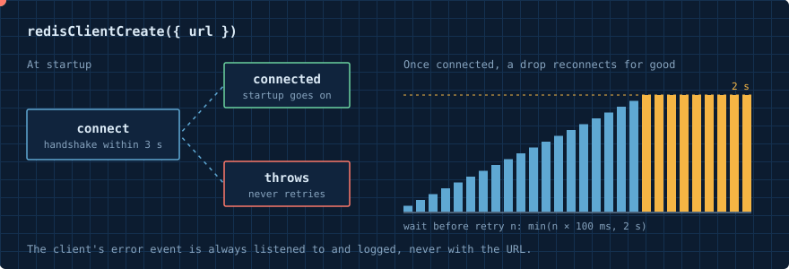

# @n8io/baseline-redis

**The one Redis connection a process shares, with the parts every app gets wrong already right.** An unreachable Redis fails startup at once instead of retrying forever, a connection dropped later reconnects for good, and the client's `error` event is always listened to, since node-redis exits the process on an unlistened one.

```sh
pnpm add @n8io/baseline-redis
```

<p align="center"></p>

## Guarantees

| You get                                 | How                                                                                     |
| --------------------------------------- | --------------------------------------------------------------------------------------- |
| **Startup fails fast**                  | The connect, handshake included, gives up after 3 s and never retries.                  |
| **Reconnects for good once up**         | A dropped connection retries every min(retries × 100 ms, 2 s), for as long as it takes. |
| **The process survives an error event** | The client's `error` event is always listened to and logged at error.                   |
| **No password in your logs**            | Errors are logged without the URL, which may carry one.                                 |
| **No command stuck waiting to be sent** | A command waits at most 1 s to be sent.                                                 |
| **One connection for cache and live**   | `cacheStoreRedisCreate` and `liveHubRedisCreate` both take the client it resolves with. |
| **Closed with its block**               | `await using` calls `close()` when the block ends.                                      |

## Example

Open one connection per process and build the cache store and live hub on it:

```ts
import { cacheStoreRedisCreate } from "@n8io/baseline-cache";
import { liveHubRedisCreate } from "@n8io/baseline-live";
import { redisClientCreate } from "@n8io/baseline-redis";

const redisClient = await redisClientCreate({ url: ENV.CACHE_URL });
const cacheStore = cacheStoreRedisCreate({ redisClient });
const liveHub = liveHubRedisCreate({ redisClient });

// At shutdown, after the live hub:
await liveHub.close();
await redisClient.close();
```

Unit tests need no Redis: build the cache and live hub on their memory stores instead. The Package's own `pnpm test` runs every test; the `*.redis.test.ts` files start a Redis container, so they need Docker.

## Reference

<details><summary><b>Exports</b></summary>

- `redisClientCreate({ url, vendor? })`: resolves with a connected node-redis client. The connect, handshake included, gives up after 3 s and never retries, so startup fails while Redis is unreachable or not answering. Once connected, a dropped connection reconnects every min(retries × 100 ms, 2 s), for as long as it takes. A command waits at most 1 s to be sent. Errors are logged at error, never with the URL, which may carry a password.
- `RedisClient`: what it resolves with, a node-redis client. Close it with `close()`; `await using` calls `close()` when its block ends.
- `RedisClientOptions`: what `redisClientCreate` takes, `{ url, vendor? }`.
- `RedisClientVendorOptions`: `vendor`, node-redis's own client settings (`socket.ca`, `name`, `keyPrefix`), outside the contract. A key the URL or this Package sets throws: `username`, `password`, `database`, `commandOptions`, `socket.host`, `socket.port`, `socket.path`, `socket.tls`, `socket.connectTimeout` and `socket.reconnectStrategy`, and `credentialsProvider` when the URL carries a user or password.

</details>

<details><summary><b>URLs, Sentinel and Cluster</b></summary>

`url` is `redis://` or `rediss://` (TLS), with any user, password and database in it. One URL fits a highly available Redis whose endpoint follows the primary: a managed one, or a proxy in front of Sentinel. For Sentinel or Cluster addressed directly, `pnpm add redis` and build the client with node-redis's `createSentinel` or `createCluster` yourself, with your own `error` listener, and pass it to the cache and live adapters, which take any connected node-redis client. Nothing tests that path.

</details>

**Needs** a Redis URL (`redis://` or `rediss://`; the Template reads it from `CACHE_URL`). Runs on node-redis.
