# @n8io/baseline-sdk

**Every SDK call has a deadline, and a read that fails for a moment is sent again.** `sdkFetchCreate` builds the fetch a Project's generated SDK calls: a timeout on each attempt and on the whole call, retries only where sending twice is safe, and the same `{ status, data, headers }` it always resolved, in Node and in browsers.

```sh
pnpm add @n8io/baseline-sdk
```

<p align="center"></p>

## Guarantees

| You get                             | How                                                                                                                                                                                                                                            |
| ----------------------------------- | ---------------------------------------------------------------------------------------------------------------------------------------------------------------------------------------------------------------------------------------------- |
| **No call that hangs**              | Each attempt has `timeout` (10 s) until its response arrives, and the whole call, retries, waits and body included, has `totalTimeout` (30 s). Either rejects with a `DOMException` named `TimeoutError`.                                      |
| **Retries only where they're safe** | GET, HEAD and DELETE are sent again, `retry` times (2), after a network failure, a timed-out attempt, or a 408, 429, 500, 502, 503 or 504. POST and PATCH are sent once: a retry could apply them twice.                                       |
| **The API's pace**                  | A `Retry-After` (seconds or a date), or a rate-limit reset header, sets the wait; otherwise it backs off from 0.3 s, doubling. When the wait would run past `totalTimeout`, that response resolves at once instead.                            |
| **No throw on a status**            | Every response, the last one after retries, resolves `{ status, data, headers }`: `data` is the parsed JSON when the content type names json, the text otherwise, or `undefined` for no body. A call rejects only when no whole response came. |
| **One instance per SDK**            | `sdkFetchCreate` holds no module state, so two SDKs in one app keep their own base URL, token and timeouts.                                                                                                                                    |
| **Traced with no code**             | With `@n8io/baseline-telemetry` started, a call made inside a span carries `traceparent`; the SDK adds no header of its own (`src/sdk-traceparent.test.ts`).                                                                                   |
| **Node and browsers**               | No `node:` import and no Node global in what ships (`src/sdk-isomorphic.test.ts`).                                                                                                                                                             |

## Example

```ts title="clients/sdk/sdk-fetch.ts"
import { sdkFetchCreate } from "@n8io/baseline-sdk";

export const { sdkConfigure, sdkFetch } = sdkFetchCreate();
```

```ts
sdkConfigure({ baseUrl: "https://api.example.com", token });
await fooList({ limit: 10 });
// An Event handler is already retried by the queue, so it sends once:
await fooDelete(fooId, { retry: 0 });
```

Test it against a real local HTTP server (`node:http`) that answers each request in turn, and count the requests it saw (`src/sdk-fetch-create.test.ts`).

## Reference

<details><summary><b>Exports</b></summary>

| Export                      | Does                                                                                                                                             |
| --------------------------- | ------------------------------------------------------------------------------------------------------------------------------------------------ |
| `sdkFetchCreate(defaults?)` | Builds one instance from `SdkOptions` and returns `SdkFetch`.                                                                                    |
| `SdkFetch`                  | `{ sdkConfigure, sdkFetch }`.                                                                                                                    |
| `sdkConfigure(options)`     | Merges `SdkOptions` into what every later call of this instance uses.                                                                            |
| `sdkFetch(url, options)`    | The generated SDK's mutator: `url` is the operation's path and query; `options` is `RequestInit` plus `SdkOptions`, which override for one call. |
| `SdkOptions`                | `{ baseUrl?, token?, timeout?, totalTimeout?, retry? }`, below.                                                                                  |

</details>

<details><summary><b>Options</b></summary>

| Option         | Default | Means                                                                                                                                |
| -------------- | ------- | ------------------------------------------------------------------------------------------------------------------------------------ |
| `baseUrl`      |         | The API's origin, such as `https://api.example.com`. A call without one rejects and says so.                                         |
| `token`        |         | Sent as `authorization: Bearer <token>`.                                                                                             |
| `timeout`      | 10000   | Milliseconds each attempt may wait for its response.                                                                                 |
| `totalTimeout` | 30000   | Milliseconds the whole call may take, retries, waits and reading the body included.                                                  |
| `retry`        | 2       | How many times a GET, HEAD or DELETE is sent again. `0` sends once: use it where a caller already retries, such as an Event handler. |

A caller's own `signal` still cancels the call; it rejects with that signal's reason.

</details>

<details><summary><b>What rejects</b></summary>

- A timeout, of an attempt after the last retry or of the whole call: a `DOMException` named `TimeoutError`, as `AbortSignal.timeout` gives.
- A network failure after the last retry: the error `fetch` gave (a `TypeError`). A connection that drops while the body is read rejects at once, without a retry.
- A JSON content type with a body that is not JSON: the `SyntaxError` from parsing it.
- No `baseUrl`: an `Error` that names `sdkConfigure`.

</details>

**Needs** `fetch`, `AbortSignal.timeout` and `AbortSignal.any` (Node 26, current browsers). Runs on ky, which never appears in its types.
