# @n8io/baseline-shutdown

**Rollouts that let running work finish**: on SIGTERM, stop taking work, let running work finish, then close resources one by one, always inside the deadline.

```sh
pnpm add @n8io/baseline-shutdown
```

<p align="center"></p>

## Guarantees

| You get                           | How                                                                                                                       |
| --------------------------------- | ------------------------------------------------------------------------------------------------------------------------- |
| **Out of rotation first**         | `isShuttingDown()` turns true at the signal, so readiness answers 503 while the process keeps serving for `drainDelayMs`. |
| **Running work finishes**         | Every intake closes at once; each stops accepting, then waits for its active work.                                        |
| **Resources outlive their users** | Resources close one by one, in the order you list them, after every intake is done; telemetry last flushes everything.    |
| **Always exits, always on time**  | At `deadlineMs` it gives up and exits, keeping the last 5 s for the resources even when an intake hangs.                  |
| **An honest exit code**           | 0 when every step closed in time; 1 when a step threw or ran late, or after a crash.                                      |
| **Crashes shut down too**         | `uncaughtException` and `unhandledRejection` are logged at fatal and run the same shutdown, with no drain.                |
| **One broken step stops nothing** | A step that throws is logged at error, and the rest still close.                                                          |

## Example

```ts
import { shutdownHandleCreate } from "@n8io/baseline-shutdown";

const shutdown = shutdownHandleCreate({
	drainDelayMs: ENV.SHUTDOWN_DRAIN_DELAY_MS ?? 5_000,
	intakes: [
		{ close: () => httpServerClose(server), name: "http" },
		{ close: () => liveHub.close(), name: "live" },
	],
	resources: [
		{ close: () => queue.close(), name: "queue" },
		{ close: () => pgPool.end(), name: "database" },
		{ close: () => health.close(), name: "health" },
		{ close: () => telemetryShutdown(), name: "telemetry" },
	],
});
```

`httpServerClose` is from `@n8io/baseline-http` and `telemetryShutdown` from `@n8io/baseline-telemetry`. A Project does not test the handle itself: it owns process signals and exits the process. Test each step's `close` on its own.

## Reference

<details><summary><b>Exports</b></summary>

| Export                                                                     | Does                                                                                                                                                                                                                                                                                                                                            |
| -------------------------------------------------------------------------- | ----------------------------------------------------------------------------------------------------------------------------------------------------------------------------------------------------------------------------------------------------------------------------------------------------------------------------------------------- |
| `shutdownHandleCreate({ intakes, resources, deadlineMs?, drainDelayMs? })` | Owns `SIGTERM`, `SIGINT`, `uncaughtException` and `unhandledRejection`, and exits the process: 0 when every step closed in time, 1 otherwise or after a crash. A second signal is ignored. A `deadlineMs` that is not an integer over 5000, or a `drainDelayMs` that is not a whole number under `deadlineMs` minus 5000, throws a `TypeError`. |
| `ShutdownOptions`                                                          | The options object above. `null` means the default, as leaving it out does.                                                                                                                                                                                                                                                                     |
| `ShutdownHandle`                                                           | `isShuttingDown()`, for `/readyz`.                                                                                                                                                                                                                                                                                                              |
| `ShutdownStep`                                                             | `{ name, close }`: one intake (HTTP server, live streams, Event handlers) or resource (queue, pools, clients, health, telemetry).                                                                                                                                                                                                               |

The steps, counted from the signal:

1. Waits `drainDelayMs` (default 5 s; the Template sets 0 in development) while readiness answers 503.
2. Closes every intake (HTTP server, live streams, Event handlers) at once. One still open at the cutoff (`deadlineMs` minus 5 s) is logged at warn, and shutdown moves on.
3. Closes each resource (queue, pools, clients, health, telemetry last) in order. One still open at the deadline is logged at error, with every resource after it.
4. Gives up at `deadlineMs` (default 25 s), keeping the last 5 s for the resources, and logs `Shutdown finished` with the exit code.
</details>

**Needs** no peers (it logs through `@n8io/baseline-logger`, a dependency); `SHUTDOWN_DRAIN_DELAY_MS` by the Template's convention (read by the caller, not this Package).
