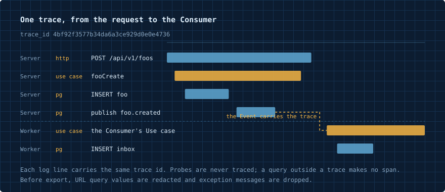

# @n8io/baseline-telemetry

**One trace from the request to the Event handler, with one preload and one wrapper**: the preload starts traces, metrics and logs before the Project loads, and every Use case gets its own span and duration metric. `@n8io/baseline-queue` carries the trace across each Event.

```sh
pnpm add @n8io/baseline-telemetry import-in-the-middle
```

<p align="center"></p>

## Guarantees

| You get                              | How                                                                                                                                                                                      |
| ------------------------------------ | ---------------------------------------------------------------------------------------------------------------------------------------------------------------------------------------- |
| **Traces, metrics and logs at boot** | One preload instruments HTTP, undici, pg, Redis, pino and the Node runtime before the Project's first import.                                                                            |
| **A span per Use case**              | `telemetryUseCasesTrace` names each span after its Use case and records `baseline.use_case.duration`.                                                                                    |
| **Expected failures stay calm**      | An `err` result sets `error.type` and leaves the status unset; only a throw sets status Error.                                                                                           |
| **No noise**                         | `/livez` and `/readyz` are never traced, and a pg or Redis call outside a trace (a queue poll, boot) makes no span.                                                                      |
| **Scrubbed before export**           | Before export, URL query values become `REDACTED` and exception messages are dropped, keeping the type and stack frames.                                                                 |
| **Routes by pattern**                | `telemetryRouterInstrumentation` names the HTTP span after the route pattern and adds a span per loader and action (API routes get theirs from `@n8io/baseline-http`'s `httpRouteName`). |
| **Exits on time**                    | With no endpoint and no exporter set, nothing exports. An exporter gives up after 1 s, and `telemetryShutdown()` never throws: a script never hangs on a missing collector.              |
| **Spans without the SDK**            | `/span` loads only the OpenTelemetry API, so a Project's Use case can add attributes or a child span with no OpenTelemetry import.                                                       |

## Example

```ts
// src/preload.ts, started with: node --import ./src/preload.ts src/server.ts
import { register } from "import-in-the-middle/register-hooks.mjs";

register();
await import("@n8io/baseline-telemetry/register");
```

```ts
import { telemetryUseCasesTrace } from "@n8io/baseline-telemetry";
import {
	telemetrySpanAttributesSet,
	telemetrySpanRun,
} from "@n8io/baseline-telemetry/span";

const fooUseCases = telemetryUseCasesTrace(
	fooUseCasesCreate(fooPortsCreate(ports)),
);

// Inside a Use case or an adapter:
telemetrySpanAttributesSet({ "foo.count": foos.length });
const rows = await telemetrySpanRun("foo.import", () => fooImport(file));
```

Tests need no collector: with no `OTEL_EXPORTER_OTLP_ENDPOINT` and no `OTEL_*_EXPORTER`, nothing exports, and `telemetryShutdown()` returns at once.

## Reference

<details><summary><b>Exports</b></summary>

| Export                                                                                      | Does                                                                                                                                                                                                                                                                                                                                                                                                                                                                                  |
| ------------------------------------------------------------------------------------------- | ------------------------------------------------------------------------------------------------------------------------------------------------------------------------------------------------------------------------------------------------------------------------------------------------------------------------------------------------------------------------------------------------------------------------------------------------------------------------------------- |
| `@n8io/baseline-telemetry/register`                                                         | The preload. It instruments HTTP, undici, pg, Redis, pino and the Node runtime, never traces `/livez` or `/readyz`, makes a pg or Redis span only inside a trace (a query in a request, a job or a Use case; never a queue poll or boot; pg's `db.client.*` metrics follow the same rule and its pool metrics start with the first query inside a trace), and redacts URL query values and drops exception messages before export. Exceptions go out as log records, not span events. |
| `telemetryUseCasesTrace(useCases)`                                                          | Wraps each Use case in a span named after it and records `baseline.use_case.duration` (seconds). An `err` result sets `error.type` but leaves the status unset; a throw sets status Error and is rethrown.                                                                                                                                                                                                                                                                            |
| `@n8io/baseline-telemetry/span`: `telemetrySpanAttributesSet(attributes)`                   | Sets facts about the work (an id, a count) on the active span, so callers need no OpenTelemetry import. Does nothing when no span is active. The `/span` entry loads only the OpenTelemetry API, not the SDK.                                                                                                                                                                                                                                                                         |
| `@n8io/baseline-telemetry/feature-flag`: `telemetryFeatureFlagEvaluationRecord(evaluation)` | Records one flag evaluation as the `feature_flag.evaluation` log record of the OpenTelemetry feature-flag conventions (key, provider name, reason, variant or a small value, `error.type`). It carries the active trace, adds nothing to the span, and never takes an evaluation context. Used by `@n8io/baseline-feature-flags`.                                                                                                                                                     |
| `@n8io/baseline-telemetry/span`: `telemetrySpanRun(name, work)`                             | Runs `work` in a child span and returns its result. Attributes set inside land on it; a throw sets status Error and `error.type`, and is rethrown.                                                                                                                                                                                                                                                                                                                                    |
| `@n8io/baseline-telemetry/span`: `TelemetryAttributes`                                      | The attributes type: `Record<string, boolean \| number \| string>`.                                                                                                                                                                                                                                                                                                                                                                                                                   |
| `telemetryRouterInstrumentation`, `TelemetryRouterInstrumentation`                          | The React Router server `instrumentations` entry. It names the HTTP span after the route pattern and adds a span per loader and action; a thrown Response (a redirect, a 404) is not an error.                                                                                                                                                                                                                                                                                        |
| `telemetryShutdown()`                                                                       | Flushes and stops every signal. List it last in the shutdown resources. It waits at most one exporter timeout (1 s by default) for the final export, never throws, and prints one warning naming the endpoint if the export failed or timed out, so a script does not hang at exit when no collector listens.                                                                                                                                                                         |

</details>

<details><summary><b>The preload file</b></summary>

Start each process with one preload file that registers the ESM loader hook in-thread (`module.registerHooks`, so Node 26 prints no DEP0205) and then imports the telemetry preload. Without the hook, ESM modules are not patched and HTTP server spans are missing. The Template's is `src/preload.ts`, shown in the Example.

</details>

<details><summary><b>Environment</b></summary>

- The standard `OTEL_*` variables, such as `OTEL_SERVICE_NAME` and `OTEL_EXPORTER_OTLP_ENDPOINT`.
- Every signal, metrics included, exports OTLP over http/protobuf only; another `OTEL_EXPORTER_OTLP_*_PROTOCOL` is ignored with a warning.
- `OTEL_TRACES_EXPORTER`, `OTEL_METRICS_EXPORTER` and `OTEL_LOGS_EXPORTER` take `otlp`, `console` or `none`. With none of them set, a signal exports OTLP only if `OTEL_EXPORTER_OTLP_ENDPOINT` (or the signal's own `OTEL_EXPORTER_OTLP_<SIGNAL>_ENDPOINT`) is set, and otherwise exports nothing, so a script does not wait at exit for a collector that is not there.
- An OTLP exporter gives up after 1 s (not the OpenTelemetry default of 10 s) unless `OTEL_EXPORTER_OTLP_TIMEOUT`, or the signal's own `OTEL_EXPORTER_OTLP_<SIGNAL>_TIMEOUT`, is set, in milliseconds.
- The batch settings `OTEL_BSP_*` and `OTEL_BLRP_*` and `OTEL_METRIC_EXPORT_INTERVAL` (default 60 s) apply as usual.

</details>

**Needs** `@opentelemetry/api` as a peer, the standard `OTEL_*` variables (above), and `import-in-the-middle` for the loader hook the preload file registers: it must resolve to the same copy `@opentelemetry/instrumentation` uses, so give it a caret range. Runs on OpenTelemetry; exports OTLP to any collector.
